# Documentacao Completa do Banco de Dados

## Produto

**JM-InvSM / Sistema de Facturacao, Inventario e Stock**

Este documento descreve o banco de dados de um produto generico, standalone, orientado a pequenas e medias operacoes comerciais. O sistema cobre cadastro base, gestao de artigos, entradas de stock, lotes, requisicoes internas, picking, compras, recebimentos de fornecedor, vendas/facturacao, pagamentos, caixa, banco/conta corrente, contas a pagar, precos, descontos e impostos.

Os modelos e regras aqui descritos foram preparados com base nos scripts consolidados:

- `00_TABELAS_COMPLETO.sql`
- `01_TRIGGERS_COMPLETO.sql`
- `02_PROCEDURES_COMPLETO.sql`
- `03_DADOS_TESTE_VALIDACAO.sql`
- `04_TABELAS_COMPRAS_CONTAS_PAGAR.sql`
- `05_REGRAS_COMPRAS_CONTAS_PAGAR.sql`
- `06_DADOS_TESTE_COMPRAS_CONTAS_PAGAR.sql`
- `07_AUDITORIA_DELETE_LOGICO_CONFIG.sql`
- `08_VALIDAR_AUDITORIA_REGISTO.sql`
- `09_CORRECAO_VENDA_MODO_FACTURACAO.sql`

> Nota: nos scripts de teste o banco alvo e `_sysface_teste`. Para producao, recomenda-se alterar o nome do schema e executar previamente em ambiente separado.

---

## 1. Visao Geral

### 1.1 Objectivo do Banco

O banco de dados tem como objectivo centralizar as operacoes de inventario e facturacao de uma instancia local do sistema. Por se tratar de um produto standalone, assume-se inicialmente uma instalacao local, com uma base de dados unica, sem dependencia obrigatoria de internet.

### 1.2 Modulos Funcionais

| Modulo | Responsabilidade |
| --- | --- |
| Administracao | Empresa, utilizadores, funcionarios, perfis, dados institucionais e configuracao global do sistema. |
| Cadastros Comerciais | Clientes, fornecedores, contactos, documentos, impostos e formas de pagamento. |
| Produtos e Inventario | Artigos, categorias, marcas, unidades, armazens, stock e lotes. |
| Entradas | Registo de compras/entradas, actualizacao de stock e criacao de lotes. |
| Requisicoes | Pedido interno de artigos, aprovacao, reserva de stock, picking e saida. |
| Compras e Recebimentos | Ordem de compra, recebimento, criacao de lotes e entrada no stock. |
| Transferencias | Envio e recepcao de stock entre armazens. |
| Facturacao | Facturas, itens de factura, cotacoes e documentos comerciais. |
| Pagamentos, Caixa e Banco | Transaccoes, pagamentos a vista, parcelas, caixa, conta corrente/banco e saldos. |
| Contas a Pagar | Factura de fornecedor, obrigacao financeira, pagamento ao fornecedor e movimento financeiro. |
| Precos e Descontos | Tabelas de preco, historico, vigencia e descontos aplicaveis. |
| Auditoria Operacional | Movimentos de stock, movimentos por lote e historico de INSERT/UPDATE/DELETE por utilizador. |
| Configuracao Operacional | Definicao do modo `FACTURACAO` ou `FACTURACAO_STOCK`. |

### 1.3 Ordem Recomendada de Implantacao

1. Executar `00_TABELAS_COMPLETO.sql`.
2. Executar `02_PROCEDURES_COMPLETO.sql`.
3. Executar `01_TRIGGERS_COMPLETO.sql`.
4. Executar `04_TABELAS_COMPRAS_CONTAS_PAGAR.sql`.
5. Executar `05_REGRAS_COMPRAS_CONTAS_PAGAR.sql`.
6. Executar `07_AUDITORIA_DELETE_LOGICO_CONFIG.sql`.
7. Copiar o resultado da coluna `SCRIPT_TRIGGERS_AUDITORIA` e executar em nova aba para criar/recriar triggers de auditoria.
8. Executar `08_VALIDAR_AUDITORIA_REGISTO.sql` para confirmar que os triggers foram aplicados e que `auditoria_registo` recebe dados.
9. Executar `09_CORRECAO_VENDA_MODO_FACTURACAO.sql` para recriar `Tg_C_Saida` respeitando `FACTURACAO`, `FACTURACAO_STOCK` e `produto.controle_stock`.
10. Executar `03_DADOS_TESTE_VALIDACAO.sql` apenas em ambiente de teste base.
11. Executar `06_DADOS_TESTE_COMPRAS_CONTAS_PAGAR.sql` apenas em ambiente de teste de compras/contas a pagar.

> Nota sobre auditoria: por limitacao do MySQL em algumas versoes/protocolos, `CREATE TRIGGER` nao deve ser executado por `PREPARE/EXECUTE` dentro de stored procedure. Por isso o script `07_AUDITORIA_DELETE_LOGICO_CONFIG.sql` gera os comandos finais na tabela auxiliar `auditoria_trigger_sql`.

---

## 2. Modelo Conceitual

### 2.1 Conceitos Principais

O modelo conceitual esta organizado em torno dos seguintes conceitos centrais:

- **Produto**: artigo comercializavel ou controlado em stock.
- **Stock**: saldo fisico e reservado por produto e armazem.
- **Lote**: unidade de rastreio de stock, normalmente associada a entrada, validade ou custo.
- **Documento Comercial**: factura, cotacao ou outro documento de venda.
- **Ordem de Compra**: compromisso formal de compra junto ao fornecedor, sem impacto directo no stock.
- **Recebimento de Compra**: confirmacao fisica de entrada, responsavel por criar lotes e actualizar stock.
- **Conta a Pagar**: obrigacao financeira criada a partir da factura do fornecedor.
- **Movimento**: evento contabilizado de entrada, saida, venda, requisicao ou transferencia.

### 2.2 MER Conceitual Geral

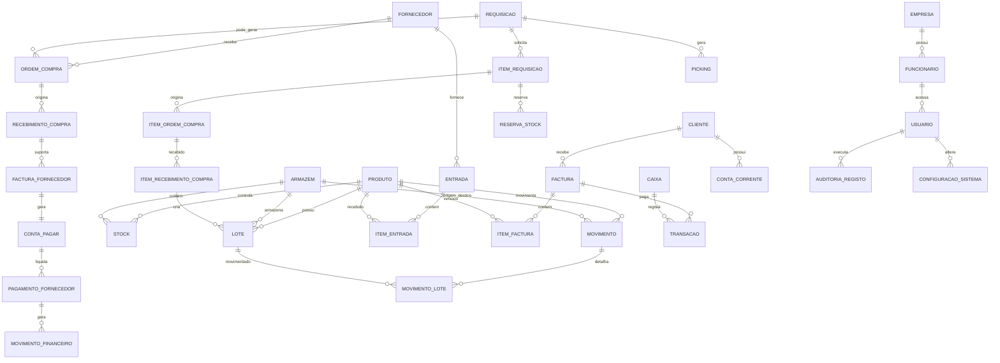

---

## 3. Modelo Logico por Modulo

### 3.1 Administracao e Acesso

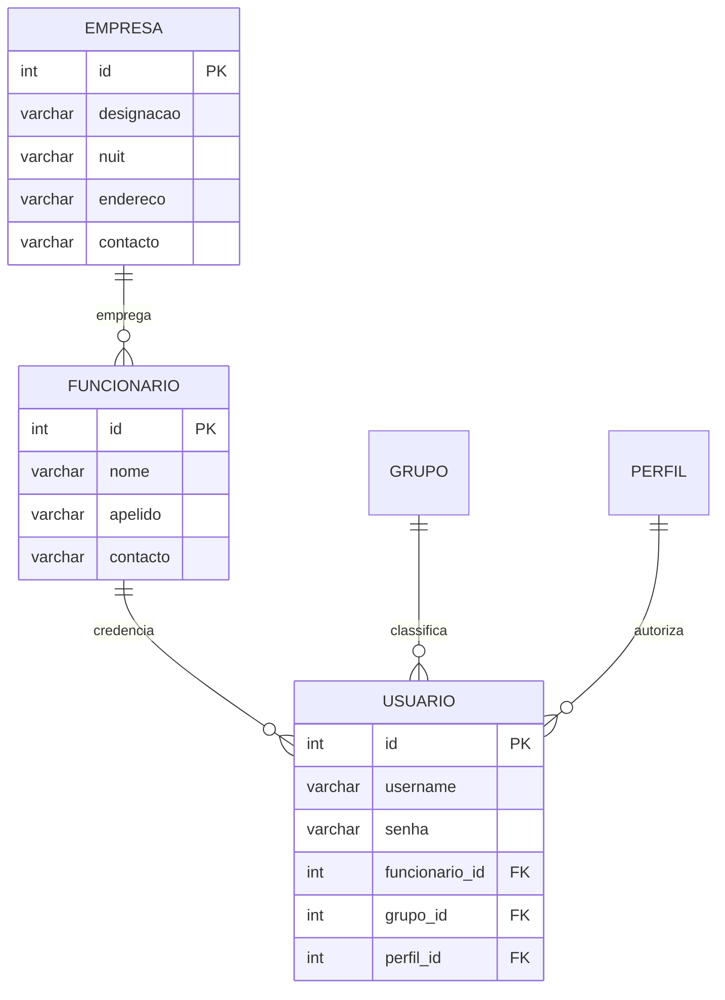

**Responsabilidade:** gerir os dados base do sistema e o acesso dos utilizadores.

**Observacoes importantes:**

- A senha deve ser armazenada com hash seguro na camada aplicacional ou em evolucao futura do modelo.
- Para produto standalone, pode existir um unico perfil administrador criado na instalacao inicial.
- A configuracao global do sistema deve possuir um registo activo principal em `configuracao_sistema` com `id = 1`.

### 3.1.1 Configuracao Operacional e Auditoria

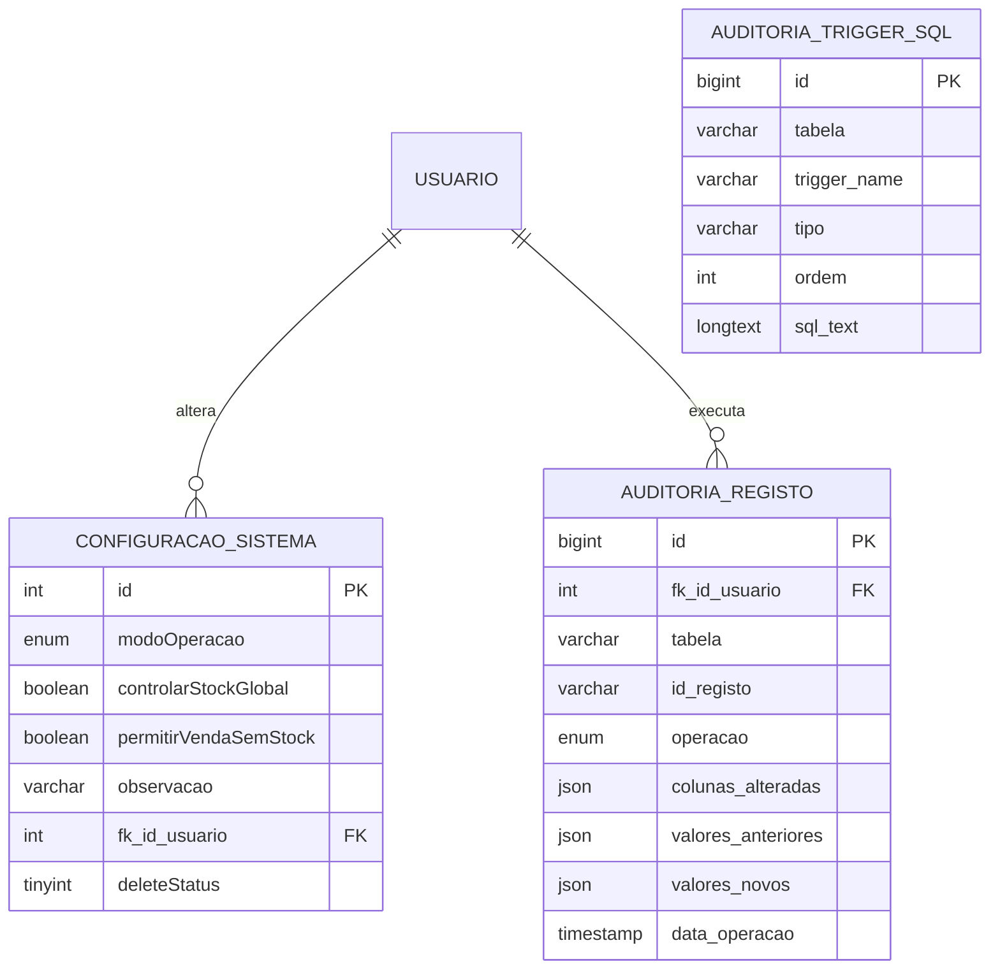

**Responsabilidade:** controlar o modo global do produto e permitir rastreio tecnico/operacional das alteracoes feitas no banco.

**Modos suportados:**

| Modo | Comportamento |
| --- | --- |
| `FACTURACAO` | Permite facturacao, pagamentos, caixa/banco e documentos comerciais sem obrigar controlo fisico de stock. |
| `FACTURACAO_STOCK` | Activa validacao de stock, reservas, picking, lotes, movimentos, recebimentos e transferencias. |

**Regras principais:**

- `configuracao_sistema.id = 1` representa a configuracao activa da instalacao.
- Em `FACTURACAO`, operacoes fisicas de stock devem ser bloqueadas ou ocultadas pela aplicacao.
- Em `FACTURACAO_STOCK`, cada produto ainda respeita `produto.controle_stock`.
- A auditoria usa a variavel de sessao `@app_user_id`, definida pela aplicacao ao obter/reutilizar uma conexao.
- Delete logico e feito por `deleteStatus = 1`, preenchendo `deletedAt` e `deletedBy`.

### 3.2 Produtos, Armazens, Stock e Lotes

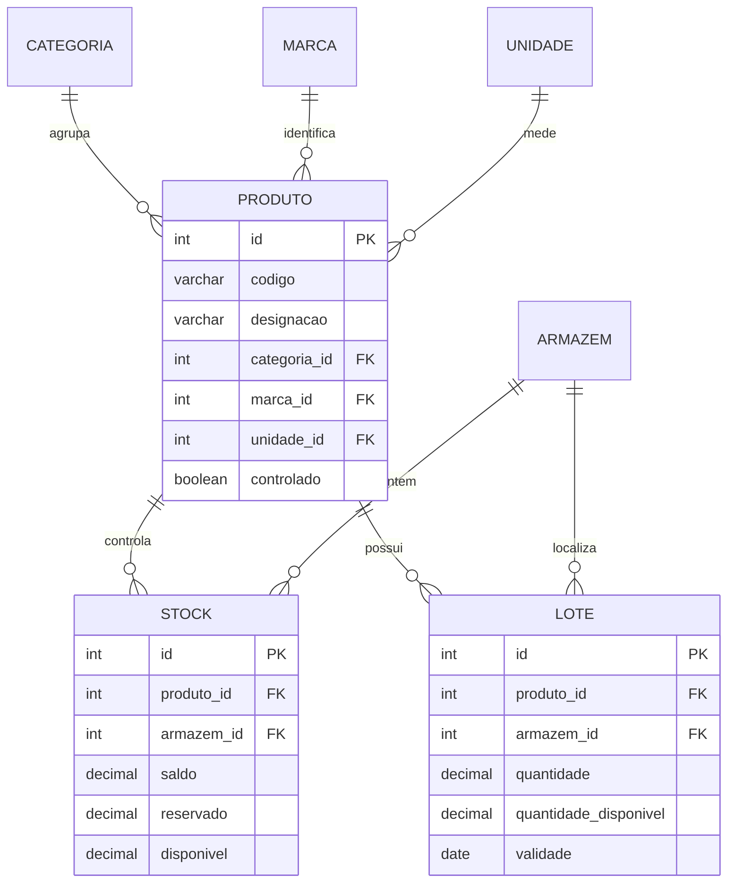

**Responsabilidade:** controlar o saldo fisico, saldo reservado e disponibilidade real dos produtos.

**Regra central:**

```text
stock.disponivel = stock.saldo - stock.reservado
```

Quando o produto e controlado em stock, as entradas, saidas e reservas devem afectar sempre o saldo do produto no armazem correspondente.

### 3.3 Entradas de Stock

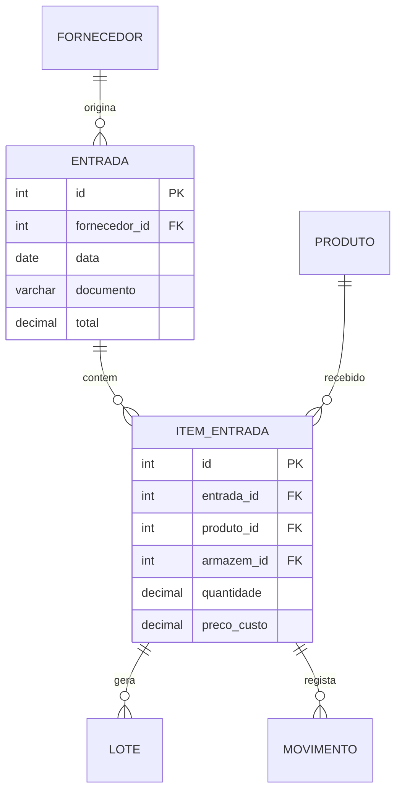

**Fluxo logico:**

1. Regista-se a entrada.
2. Registam-se os itens de entrada.
3. O sistema cria ou actualiza stock.
4. O sistema cria lote quando aplicavel.
5. O sistema cria movimento de entrada.

### 3.4 Requisicoes, Reservas e Picking

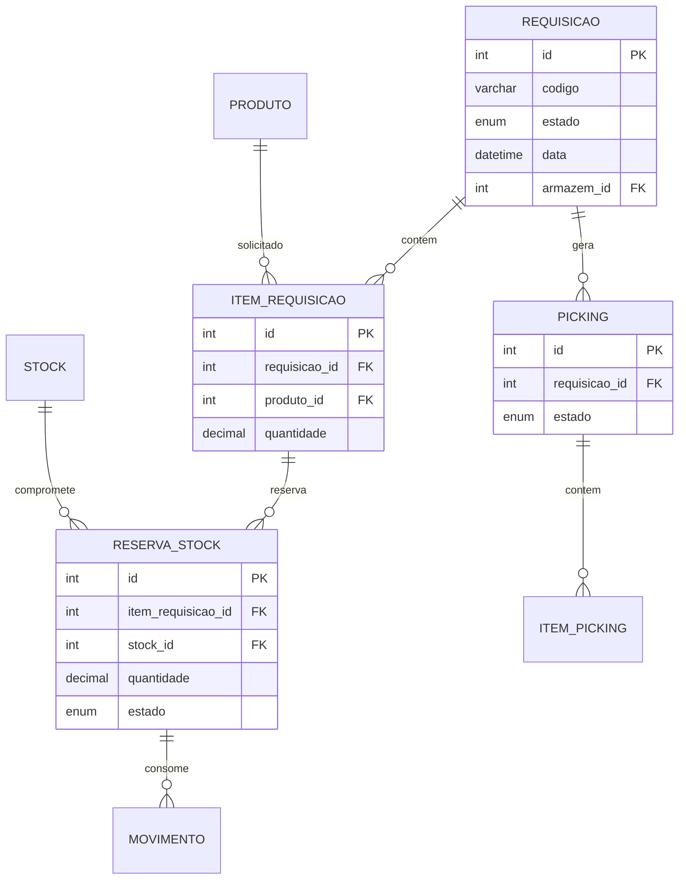

**Estados recomendados da requisicao:**

| Estado | Significado |
| --- | --- |
| `Pendente` | Requisicao criada, ainda editavel. |
| `Submetida` | Requisicao enviada para aprovacao. |
| `Aprovada` | Stock validado e reservado. |
| `Finalizada` | Picking confirmado e stock baixado. |
| `Cancelada` | Processo interrompido antes da finalizacao. |

**Fluxo operacional:**

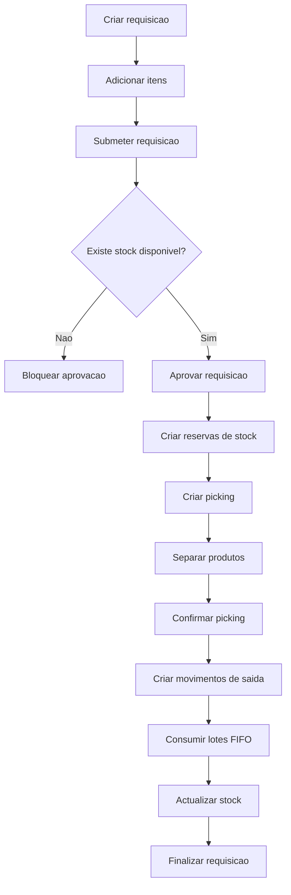

### 3.5 Compras, Recebimentos e Contas a Pagar

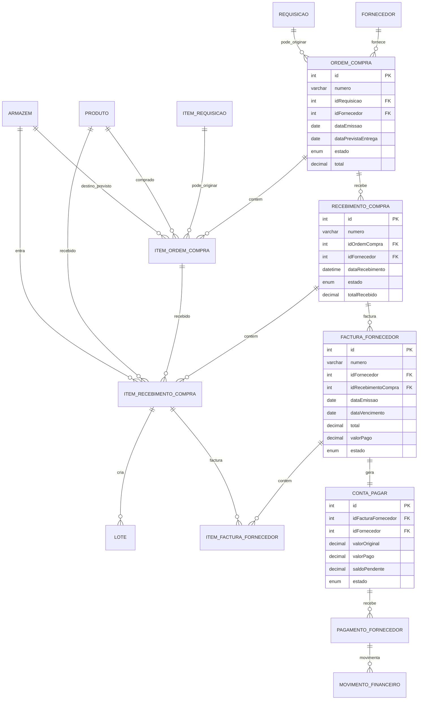

**Responsabilidade:** controlar o ciclo de compra desde a requisicao aprovada ate a obrigacao financeira e respectivo pagamento ao fornecedor.

**Regras centrais:**

1. Requisicao de compra nao actualiza stock, caixa, banco ou contas a pagar.
2. Ordem de compra representa compromisso com fornecedor e nao altera stock nem financeiro.
3. Recebimento confirmado cria lote, confirma itens recebidos, actualiza o estado da ordem e, quando a ordem vem de requisicao, finaliza a requisicao de compra sem gerar saida de stock.
4. Factura do fornecedor cria a obrigacao em `conta_pagar`.
5. Pagamento ao fornecedor reduz ou liquida `conta_pagar`, actualiza a factura do fornecedor e cria `movimento_financeiro`.
6. Se o pagamento for por `Caixa`, a saida financeira afecta caixa; se for por `Banco`, exige conta bancaria.

**Estados principais:**

| Entidade | Estados |
| --- | --- |
| `ordem_compra` | `Rascunho`, `Submetida`, `Aprovada`, `Enviada`, `ParcialmenteRecebida`, `Recebida`, `Cancelada` |
| `item_ordem_compra` | `Pendente`, `ParcialmenteRecebido`, `Recebido`, `Cancelado` |
| `recebimento_compra` | `Rascunho`, `Confirmado`, `Cancelado` |
| `item_recebimento_compra` | `Pendente`, `Confirmado`, `Cancelado` |
| `factura_fornecedor` | `Pendente`, `ParcialmentePaga`, `Paga`, `Cancelada` |
| `conta_pagar` | `Aberta`, `Parcial`, `Liquidada`, `Vencida`, `Cancelada` |
| `pagamento_fornecedor` | `Confirmado`, `Cancelado` |

### 3.6 Transferencias entre Armazens

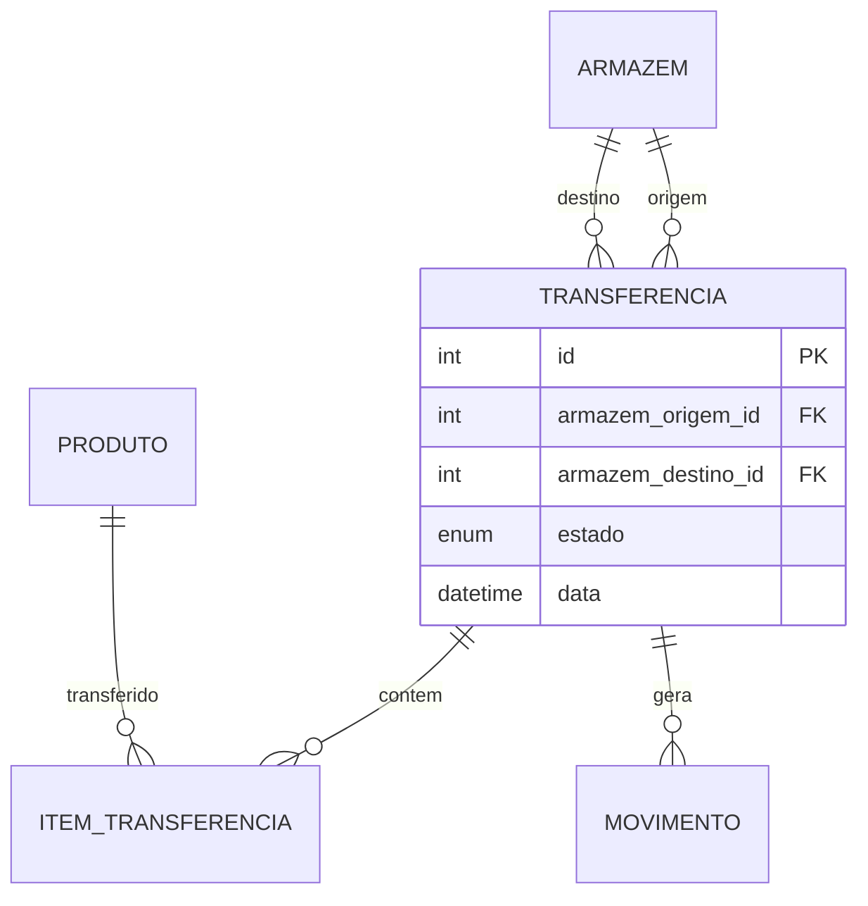

**Responsabilidade:** permitir movimentacao interna de stock entre armazens.

**Observacao:** a transferencia deve respeitar a mesma disciplina de stock disponivel usada nas requisicoes e vendas. Para evolucao futura, recomenda-se associar transferencia a lotes especificos ou aplicar FIFO de forma consistente.

### 3.7 Facturacao e Vendas

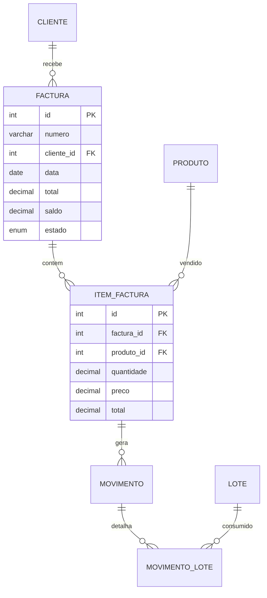

**Fluxo de venda:**

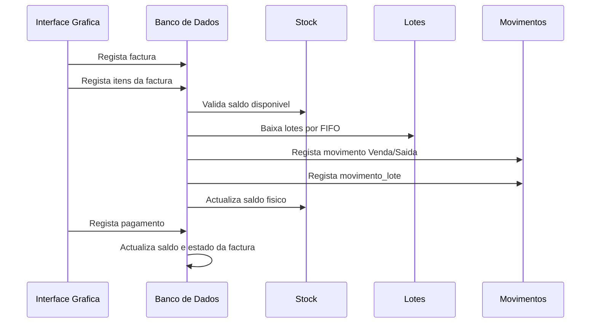

**Regra importante:** a venda so deve ser concluida quando houver stock disponivel suficiente. A saida deve afectar:

- `stock.saldo`
- `lote.quantidade_disponivel`
- `movimento`
- `movimento_lote`

### 3.8 Pagamentos, Caixa, Banco e Conta Corrente

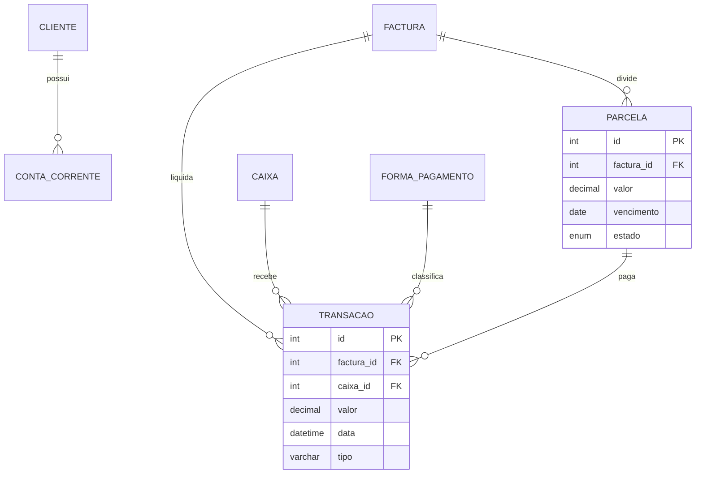

**Responsabilidade:** controlar liquidacoes, recebimentos, saldos de factura, caixa e conta corrente.

**Fluxos esperados:**

- Pagamento a vista: factura emitida, pagamento registado, caixa actualizado e factura liquidada ou parcialmente liquidada.
- Pagamento parcelado: parcelas criadas, vencimentos acompanhados, juros/taxas aplicadas quando configurado.

### 3.9 Precos, Descontos e Impostos

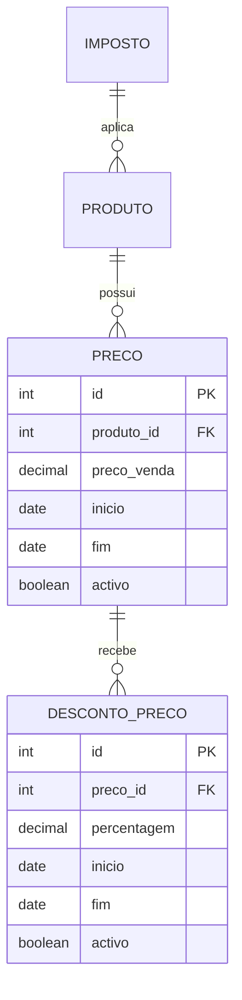

**Responsabilidade:** manter historico e vigencia dos precos, descontos e impostos aplicaveis.

---

## 4. Modelo Fisico

### 4.1 Plataforma

| Item | Valor |
| --- | --- |
| SGBD | MySQL |
| Schema de teste | `_sysface_teste` |
| Codificacao recomendada | `utf8mb4` |
| Motor recomendado | `InnoDB` |
| Uso | Produto standalone/local |

### 4.2 Convencoes Observadas

| Aspecto | Observacao |
| --- | --- |
| Chaves primarias | Predominantemente inteiros auto-incrementais. |
| Relacionamentos | Implementados via FKs em varias tabelas centrais. |
| Nomes | Ha mistura de estilos; recomenda-se padronizacao futura. |
| Regras automaticas | Concentradas em triggers, procedures e events. |
| Stock disponivel | Calculado a partir de saldo menos reservado. |
| Delete logico | Registos devem ser desactivados por `deleteStatus = 1`, preservando historico. |
| Auditoria | Alteracoes devem ser rastreadas por triggers geradas a partir de `auditoria_trigger_sql`. |

### 4.3 Entidades Centrais e Relacionamentos

| Entidade | Papel no Modelo | Relacionamentos Principais |
| --- | --- | --- |
| `produto` | Artigo vendido, comprado ou requisitado. | Categoria, marca, unidade, stock, lote, factura, requisicao. |
| `stock` | Saldo por produto/armazem. | Produto, armazem, reserva, movimento. |
| `lote` | Rastreio de quantidade disponivel por origem/validade. | Produto, armazem, movimento_lote. |
| `movimento` | Historico de entradas e saidas. | Produto, armazem, movimento_lote. |
| `movimento_lote` | Detalhe de lote consumido/afectado por movimento. | Movimento, lote. |
| `factura` | Documento comercial de venda. | Cliente, itemfactura, transacoes, parcelas. |
| `itemfactura` | Linha de venda. | Factura, produto. |
| `requisicao` | Pedido interno de produtos. | Itens, picking, reservas. |
| `reserva_stock` | Bloqueio temporario de stock disponivel. | Item de requisicao, stock. |
| `picking` | Separacao de produtos aprovados. | Requisicao, itens de picking. |
| `transacoes` | Pagamentos e movimentos financeiros. | Factura, caixa, forma de pagamento. |
| `ordem_compra` | Compromisso de compra com fornecedor. | Requisicao, fornecedor, itens da ordem. |
| `item_ordem_compra` | Linha da ordem de compra. | Ordem, produto, armazem, item de requisicao. |
| `recebimento_compra` | Confirmacao de recebimento de compra. | Ordem de compra, fornecedor, itens recebidos. |
| `item_recebimento_compra` | Linha recebida fisicamente. | Recebimento, item da ordem, produto, armazem, lote. |
| `factura_fornecedor` | Documento fiscal/financeiro do fornecedor. | Fornecedor, ordem, recebimento, conta a pagar. |
| `item_factura_fornecedor` | Linha da factura do fornecedor. | Factura do fornecedor, item recebido, produto. |
| `conta_pagar` | Obrigacao financeira com fornecedor. | Factura do fornecedor, fornecedor, pagamentos. |
| `pagamento_fornecedor` | Pagamento efectuado ao fornecedor. | Conta a pagar, fornecedor, metodo, banco/caixa. |
| `movimento_financeiro` | Historico financeiro normalizado. | Transacao, pagamento fornecedor, banco/caixa. |
| `configuracao_sistema` | Configuracao global da instalacao. | Usuario, modo de operacao, politicas de stock. |
| `auditoria_registo` | Historico tecnico/operacional de alteracoes. | Usuario, tabela alterada, registo alterado, valores antes/depois. |
| `auditoria_trigger_sql` | Tabela auxiliar para gerar triggers de auditoria. | Tabela auditada, trigger, tipo e SQL final. |

---

## 5. Dicionario de Dados Resumido

### 5.1 Administracao

| Tabela | Responsabilidade | PK | Observacoes |
| --- | --- | --- | --- |
| `empresa` | Dados da entidade que usa o sistema. | `id` | Base para documentos e relatorios. |
| `funcionario` | Pessoas internas da empresa. | `id` | Pode estar associado a utilizador. |
| `usuario` | Credenciais de acesso. | `id` | Recomenda-se senha com hash. |
| `grupo` | Agrupamento de utilizadores. | `id` | Usado para organizacao/permissao. |
| `perfil` | Perfil de acesso. | `id` | Pode suportar autorizacoes. |
| `configuracao_sistema` | Modo de operacao e politicas globais. | `id` | Deve existir um registo activo principal com `id = 1`. |
| `auditoria_registo` | Rastreio de INSERT, UPDATE e DELETE logico. | `id` | Usa `@app_user_id` para identificar o utilizador da conexao. |
| `auditoria_trigger_sql` | Armazena SQL gerado para triggers de auditoria. | `id` | O resultado deve ser copiado e executado numa nova aba SQL. |

### 5.2 Cadastros Comerciais

| Tabela | Responsabilidade | PK | Observacoes |
| --- | --- | --- | --- |
| `cliente` | Clientes de venda. | `id` | Relaciona-se com factura e conta corrente. |
| `fornecedor` | Fornecedores de compra. | `id` | Relaciona-se com entradas. |
| `contacto` | Contactos adicionais. | `id` | Suporte a clientes/fornecedores/empresa. |
| `documento` | Documentos de referencia. | `id` | Pode classificar documentos comerciais. |
| `imposto` | Configuracao fiscal. | `id` | IVA e outros impostos. |
| `forma_pagamento` | Meios de pagamento. | `id` | Caixa, banco, numerario etc. |

### 5.3 Produtos e Stock

| Tabela | Responsabilidade | PK | Observacoes |
| --- | --- | --- | --- |
| `produto` | Cadastro de artigos. | `id` | Entidade central do inventario. |
| `categoria` | Classificacao de produtos. | `id` | Agrupamento comercial. |
| `marca` | Marca do produto. | `id` | Opcional conforme negocio. |
| `unidade` | Unidade de medida. | `id` | Ex.: unidade, caixa, kg. |
| `armazem` | Local fisico/logico de stock. | `id` | Base para saldo por produto. |
| `stock` | Saldo por produto/armazem. | `id` | Contem saldo, reservado e disponivel. |
| `lote` | Quantidade rastreavel por produto/armazem. | `id` | Usado em FIFO e validade. |

### 5.4 Entradas

| Tabela | Responsabilidade | PK | Observacoes |
| --- | --- | --- | --- |
| `entrada` | Cabecalho de compra/entrada. | `id` | Associada a fornecedor. |
| `itementrada` | Linhas da entrada. | `id` | Actualiza stock e lote. |

### 5.5 Requisicoes

| Tabela | Responsabilidade | PK | Observacoes |
| --- | --- | --- | --- |
| `requisicao` | Pedido interno. | `id` | Controlado por estados. |
| `itemrequisicao` | Produtos solicitados. | `id` | Base para reserva. |
| `reserva_stock` | Reserva de saldo disponivel. | `id` | Aumenta `stock.reservado`. |
| `picking` | Processo de separacao. | `id` | Criado apos aprovacao. |
| `itempicking` | Itens separados. | `id` | Detalhe operacional do picking. |

### 5.6 Compras e Recebimentos

| Tabela | Responsabilidade | PK | Observacoes |
| --- | --- | --- | --- |
| `ordem_compra` | Cabecalho do compromisso de compra. | `id` | Pode ser gerada por requisicao aprovada ou criada manualmente. |
| `item_ordem_compra` | Produtos solicitados ao fornecedor. | `id` | Controla quantidade solicitada, recebida e pendente. |
| `recebimento_compra` | Cabecalho do recebimento fisico. | `id` | A confirmacao dispara lote, entrada e actualizacao da ordem. |
| `item_recebimento_compra` | Produtos efectivamente recebidos. | `id` | Gera ou associa lote e alimenta factura do fornecedor. |

### 5.7 Contas a Pagar de Fornecedor

| Tabela | Responsabilidade | PK | Observacoes |
| --- | --- | --- | --- |
| `factura_fornecedor` | Registo da factura recebida do fornecedor. | `id` | Pode ser criada a partir de recebimento confirmado. |
| `item_factura_fornecedor` | Linhas da factura do fornecedor. | `id` | Pode referenciar itens recebidos. |
| `conta_pagar` | Obrigacao financeira criada pela factura. | `id` | Controla valor original, pago, saldo e estado. |
| `pagamento_fornecedor` | Baixa parcial ou total da conta a pagar. | `id` | Valida saldo pendente, origem Caixa/Banco e utilizador. |
| `movimento_financeiro` | Registo de saida/entrada financeira. | `id` | Guarda saldo anterior/posterior e origem do movimento. |

### 5.8 Transferencias

| Tabela | Responsabilidade | PK | Observacoes |
| --- | --- | --- | --- |
| `transferencia` | Cabecalho da transferencia. | `id` | Origem, destino e estado. |
| `itemtransferencia` | Produtos transferidos. | `id` | Deve validar stock disponivel. |

### 5.9 Facturacao

| Tabela | Responsabilidade | PK | Observacoes |
| --- | --- | --- | --- |
| `factura` | Documento de venda. | `id` | Controla total, saldo e estado. |
| `itemfactura` | Linhas da factura. | `id` | Dispara saida de stock. |
| `cotacao` | Proposta/orcamento. | `id` | Pode originar venda. |
| `itemcotacao` | Linhas da cotacao. | `id` | Inclui unidade e quantidade por unidade. |

### 5.10 Financeiro de Clientes, Caixa e Banco

| Tabela | Responsabilidade | PK | Observacoes |
| --- | --- | --- | --- |
| `transacoes` | Recebimentos/pagamentos. | `id` | Afecta caixa e factura. |
| `caixa` | Saldos de caixa. | `id` | Controla entradas financeiras. |
| `conta_corrente` | Saldo por cliente. | `id` | Apoia credito e debito. |
| `parcela` | Pagamentos parcelados. | `id` | Controla vencimento e atraso. |
| `contabancaria` | Conta bancaria usada em pagamentos/recebimentos. | `id` | Necessaria para movimentos financeiros por banco. |
| `movimento_financeiro` | Historico financeiro de entradas e saidas. | `id` | Tambem usado no pagamento ao fornecedor. |

### 5.11 Precos

| Tabela | Responsabilidade | PK | Observacoes |
| --- | --- | --- | --- |
| `preco` | Historico/vigencia de preco. | `id` | Um produto pode ter varios precos ao longo do tempo. |
| `desconto_preco` | Desconto associado ao preco. | `id` | Deve respeitar periodo de validade. |

### 5.12 Colunas Transversais de Delete Logico

As tabelas de negocio passam a possuir, quando aplicavel, campos transversais para desactivacao logica:

| Coluna | Tipo esperado | Responsabilidade |
| --- | --- | --- |
| `deleteStatus` | `TINYINT` | `0` indica registo activo; `1` indica registo desactivado. |
| `deletedAt` | `DATETIME/TIMESTAMP` | Data/hora em que o registo foi desactivado. |
| `deletedBy` | `INT` | Utilizador responsavel pela desactivacao logica. |

**Regra de uso:** DAOs, services e views devem listar e reutilizar apenas registos com `deleteStatus = 0`, excepto em telas administrativas de auditoria, recuperacao ou consulta historica.

---

## 6. Regras de Negocio Automatizadas

### 6.1 Regras de Stock

1. Produto controlado deve possuir linha em `stock` para o armazem correspondente.
2. Entrada de produto aumenta `stock.saldo`.
3. Saida por venda diminui `stock.saldo`.
4. Requisicao aprovada aumenta `stock.reservado`.
5. Picking confirmado consome a reserva e diminui `stock.saldo`.
6. O stock disponivel deve considerar sempre o saldo menos o reservado.
7. Lotes devem ser consumidos por FIFO quando houver saida.
8. Recebimento de compra confirmado cria lote e disponibiliza quantidade recebida para operacoes futuras.

### 6.2 Regras de Reserva

1. Nao deve ser possivel reservar mais do que o disponivel.
2. Reserva activa aumenta `stock.reservado`.
3. Reserva consumida, liberada ou cancelada reduz `stock.reservado`.
4. A aprovacao da requisicao so deve ocorrer quando todos os itens possuem stock suficiente.

### 6.3 Regras de Venda

1. Cada item de factura deve validar stock disponivel.
2. A saida deve criar movimento com origem de venda.
3. A saida deve registar os lotes consumidos.
4. O saldo do lote e o saldo do stock devem ser actualizados na mesma operacao logica.

### 6.4 Regras Financeiras

1. Pagamentos devem reduzir o saldo da factura.
2. Pagamentos a vista devem actualizar caixa.
3. Parcelas vencidas podem actualizar estado e aplicar taxa de atraso.
4. Factura deve mudar de estado conforme saldo pendente.

### 6.5 Regras de Compras e Contas a Pagar

1. `CriarOrdemCompraDeRequisicao` aceita apenas requisicoes em estado `Aprovada`.
2. Nao deve existir mais de uma ordem de compra activa para a mesma requisicao e fornecedor.
3. Ordem de compra nao altera stock, caixa, banco ou contas a pagar.
4. `ConfirmarRecebimentoCompra` aceita apenas recebimentos em `Rascunho` e com itens pendentes.
5. Recebimento confirmado cria lote, associa o lote ao item recebido e actualiza as quantidades recebidas da ordem.
6. A quantidade recebida nao pode ultrapassar a quantidade pendente do item da ordem.
7. Quando a ordem veio de requisicao e o item da ordem ainda tem custo `0.00`, o custo informado no recebimento actualiza `item_ordem_compra.custoUnitario` e recalcula `ordem_compra.subtotal`.
8. Ordem de compra passa para `ParcialmenteRecebida` ou `Recebida` conforme o estado dos seus itens.
9. Quando a ordem de compra originou de uma requisicao e todos os itens foram recebidos, a requisicao fica `Finalizada`, as reservas ficam `Liberado` e o picking fica `Confirmado`, sem criar movimento `Requisicao/Saida`.
10. `ConfirmarPicking` bloqueia requisicoes vinculadas a ordem de compra activa; essas requisicoes devem ser encerradas pelo recebimento.
11. `CriarFacturaFornecedorDeRecebimento` aceita apenas recebimentos `Confirmado`.
12. Ao inserir `factura_fornecedor`, `Tg_factura_fornecedor_cria_conta_pagar` cria automaticamente a obrigacao em `conta_pagar`.
13. `RegistarPagamentoFornecedor` cria `pagamento_fornecedor`; os triggers validam saldo, fornecedor, origem do pagamento e utilizador.
14. Pagamento por `Banco` exige `idContaBancaria`; pagamento por `Caixa` nao exige conta bancaria.
15. Pagamento confirmado actualiza `conta_pagar`, `factura_fornecedor`, `transacoes` e `movimento_financeiro`.

### 6.6 Regras de Modo de Operacao

1. `FACTURACAO` permite vendas, cotacoes, facturas, pagamentos, caixa, banco e contas, sem exigir movimento fisico de stock.
2. `FACTURACAO_STOCK` activa validacao de stock, reservas, picking, lotes, movimentos, recebimentos e transferencias.
3. A configuracao global e lida em `configuracao_sistema.id = 1`.
4. Mesmo em `FACTURACAO_STOCK`, cada produto deve respeitar `produto.controle_stock`.
5. Services criticos devem consultar o modo antes de executar operacoes que impactam stock.

### 6.7 Regras de Auditoria e Delete Logico

1. Deletes de negocio devem ser convertidos em delete logico por `sp_soft_delete` ou por services/DAOs equivalentes.
2. Consultas operacionais devem filtrar `deleteStatus = 0`.
3. Operacoes de INSERT, UPDATE e DELETE logico devem ser registadas em `auditoria_registo`.
4. A aplicacao deve definir `@app_user_id` ao abrir ou reutilizar uma conexao.
5. Triggers de auditoria sao geradas em duas etapas: gerar SQL em `auditoria_trigger_sql` e executar o script resultante manualmente.

---

## 7. Inventario de Triggers

| Trigger | Modulo | Responsabilidade |
| --- | --- | --- |
| `Tg_C_Stock` | Inventario | Criar/garantir stock para produto controlado. |
| `copiar_saldo_para_lote` | Entradas/Lotes | Replicar quantidade inicial para disponibilidade do lote. |
| `Tg_registaMovimentoEntrada` | Entradas | Registar movimento de entrada por compra. |
| `Tg_actualizaStock_IO` | Entradas | Actualizar saldo de stock apos entrada. |
| `Tg_reservaStock_validar` | Requisicoes | Validar disponibilidade antes de reservar. |
| `Tg_reservaStock` | Requisicoes | Aumentar reservado apos reserva activa. |
| `Tg_reservaStock_estado` | Requisicoes | Libertar reservado quando reserva muda de estado. |
| `Tg_estadoRequisicao` | Requisicoes | Controlar estado inicial/submissao da requisicao. |
| `Tg_FIFO` | Stock/Lotes | Apoiar consumo FIFO de lotes. |
| `Tg_C_Saida` | Vendas | Registar saida de stock por venda, lote e movimento. |
| Triggers financeiros `_update...` | Financeiro | Actualizar factura, caixa, conta corrente e saldos. |
| `Tg_factura_fornecedor_cria_conta_pagar` | Contas a Pagar | Criar automaticamente `conta_pagar` ao registar factura do fornecedor. |
| `Tg_pagamento_fornecedor_validar` | Contas a Pagar | Validar saldo, fornecedor, origem Caixa/Banco e utilizador antes do pagamento. |
| `Tg_pagamento_fornecedor_liquidar` | Contas a Pagar | Baixar conta a pagar, factura do fornecedor, transacao e movimento financeiro. |
| `trg_audit_*_ai` | Auditoria | Registar INSERT da tabela auditada em `auditoria_registo`. |
| `trg_audit_*_au` | Auditoria | Registar UPDATE da tabela auditada, incluindo delete logico, em `auditoria_registo`. |

---

## 8. Inventario de Procedures e Events

### 8.1 Procedures

| Procedure | Modulo | Responsabilidade |
| --- | --- | --- |
| `AprovarRequisicao` | Requisicoes | Validar stock, criar reservas e gerar picking. |
| `ConfirmarPicking` | Requisicoes | Consumir reservas, baixar stock/lotes e finalizar requisicao interna; bloqueia requisicoes vinculadas a ordem de compra activa. |
| `EnviarTransferencia` | Transferencias | Registar envio entre armazens. |
| `ReceberTransferencia` | Transferencias | Confirmar recepcao no armazem destino. |
| `sp_registar_preco` | Precos | Registar novo preco com vigencia. |
| `sp_aplicar_desconto_ao_preco` | Precos | Aplicar desconto a preco existente. |
| `procedure_updatePrecoVenda` | Precos | Actualizar preco de venda. |
| `procedure_updateEstadoParcela` | Financeiro | Actualizar estado de parcelas. |
| `procedure_updateTaxaAtrasoParcela` | Financeiro | Calcular taxa de atraso. |
| `procedure_updateSaldoFactura_com_Atraso_de_Parcela` | Financeiro | Actualizar saldo de factura com atrasos. |
| `CriarOrdemCompraDeRequisicao` | Compras | Gerar ordem de compra e itens a partir de requisicao aprovada. |
| `ConfirmarRecebimentoCompra` | Compras/Stock | Confirmar recebimento, criar lotes, actualizar itens/ordem e finalizar requisicao de compra sem saida. |
| `CriarFacturaFornecedorDeRecebimento` | Compras/Financeiro | Criar factura do fornecedor e itens a partir de recebimento confirmado. |
| `RegistarPagamentoFornecedor` | Contas a Pagar | Registar pagamento ao fornecedor para liquidacao parcial ou total. |
| `sp_apply_delete_logico_columns` | Auditoria/Delete Logico | Adicionar colunas transversais de delete logico nas tabelas de negocio. |
| `sp_soft_delete` | Auditoria/Delete Logico | Desactivar um registo sem apagar fisicamente, preenchendo utilizador e data. |
| `sp_generate_audit_trigger_sql_for_table` | Auditoria | Gerar SQL dos triggers de auditoria para uma tabela especifica. |
| `sp_generate_all_audit_trigger_sql` | Auditoria | Gerar SQL dos triggers de auditoria para todas as tabelas elegiveis. |

### 8.2 Events

| Event | Modulo | Responsabilidade |
| --- | --- | --- |
| `evt_marcar_expiracao_precos` | Precos | Expirar precos fora de vigencia. |
| `evento_updatePrecoVenda` | Precos | Actualizacao periodica de preco de venda. |
| `evento_updateEstadoParcela` | Financeiro | Actualizacao periodica de estado de parcelas. |
| `evento_updateTaxaAtrasoParcela` | Financeiro | Actualizacao periodica de taxa de atraso. |
| `evento_updateSaldoFactura_com_Atraso_de_Parcela` | Financeiro | Actualizacao periodica de saldos com atraso. |

---

## 9. Fluxos Detalhados

### 9.1 Entrada de Stock

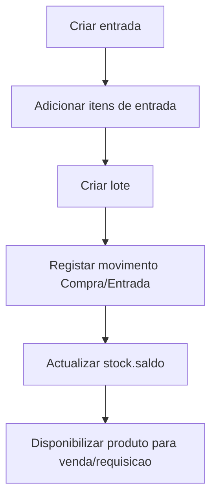

### 9.2 Venda com Baixa de Stock

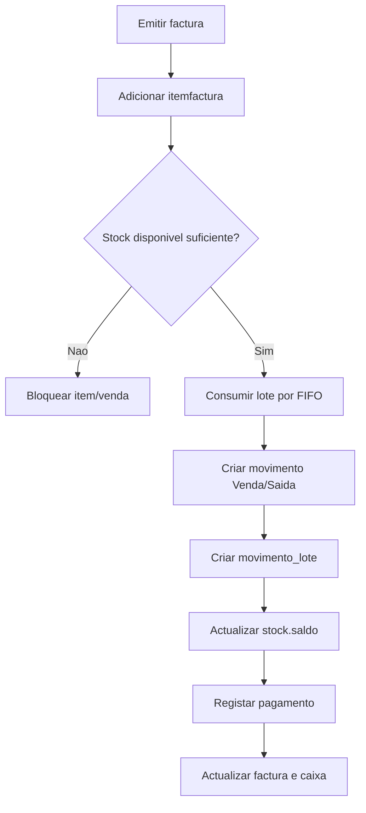

### 9.3 Requisicao com Reserva

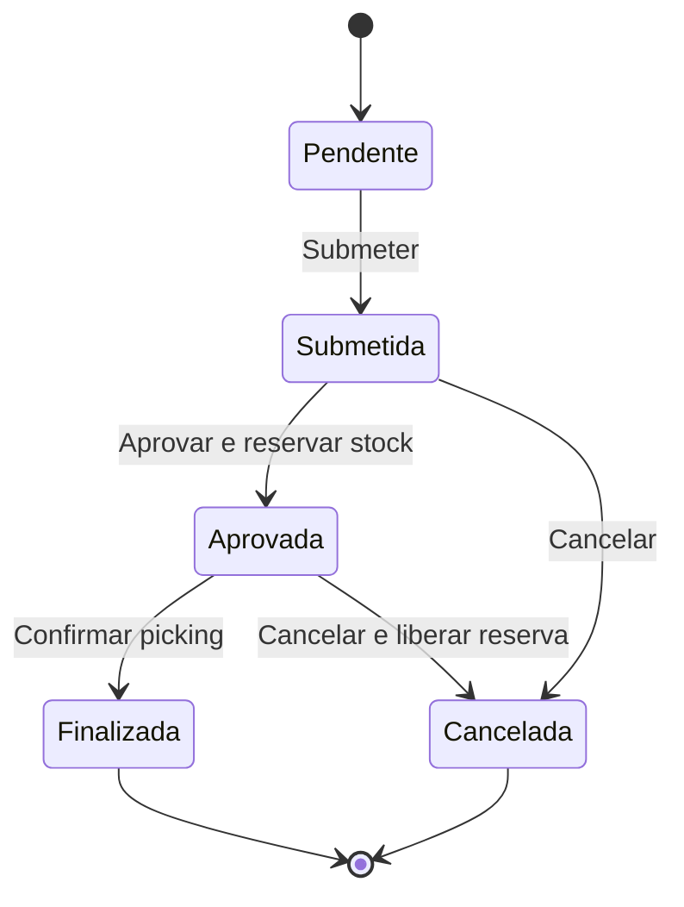

### 9.4 Ordem de Compra, Recebimento e Entrada no Stock

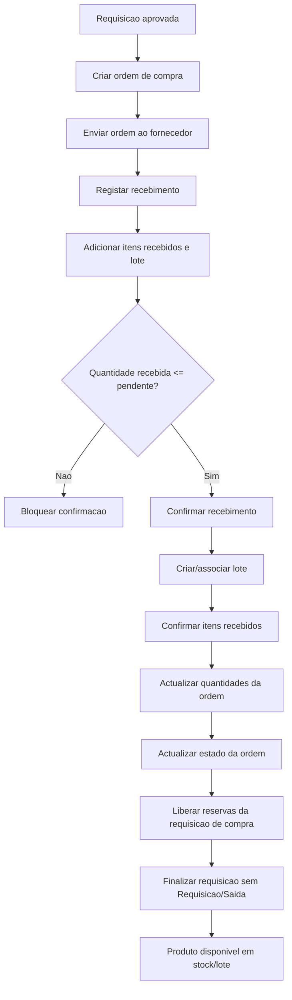

**Impacto operacional por modulo:**

| Modulo | Actualiza Stock | Actualiza Caixa | Actualiza Banco | Actualiza Contas a Pagar |
| --- | --- | --- | --- | --- |
| Requisicao de Compra | Nao | Nao | Nao | Nao |
| Ordem de Compra | Nao | Nao | Nao | Nao, apenas compromisso |
| Recebimento de Compra | Sim, entrada/lote | Nao | Nao | Opcional, apenas se factura for registada depois |
| Factura do Fornecedor | Nao | Nao | Nao | Sim, cria obrigacao |
| Pagamento ao Fornecedor | Nao | Sim, se origem `Caixa` | Sim, se origem `Banco` | Sim, reduz ou liquida divida |

### 9.5 Factura do Fornecedor, Conta a Pagar e Pagamento

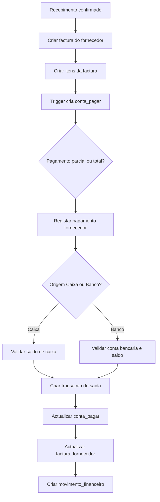

**Estados esperados no financeiro de fornecedor:**

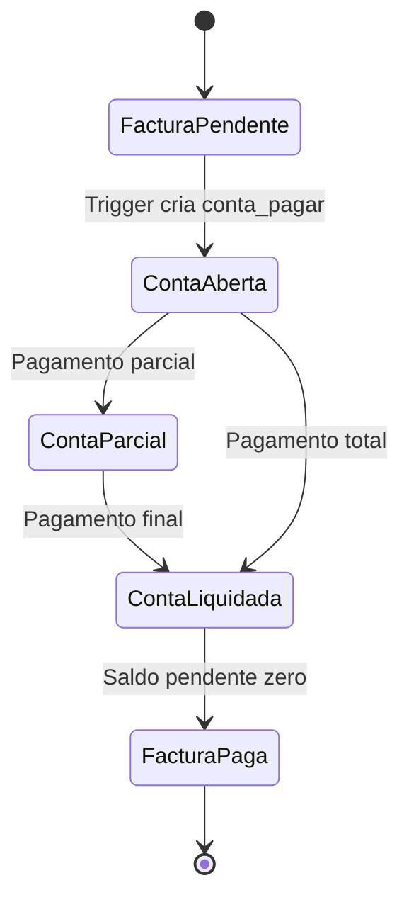

### 9.6 Pagamento Parcelado

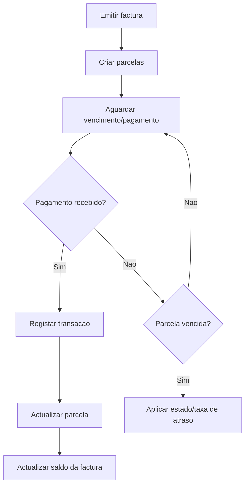

### 9.7 Modo de Operacao e Auditoria

```mermaid
flowchart TD
    A["Administrador abre configuracao"] --> B["Selecciona modo de operacao"]
    B --> C{"Modo escolhido"}
    C -- "FACTURACAO" --> D["Activar facturacao sem controlo obrigatorio de stock"]
    C -- "FACTURACAO_STOCK" --> E["Activar facturacao com stock, lotes, reservas e movimentos"]
    D --> F["Actualizar configuracao_sistema"]
    E --> F
    F --> G["Trigger regista UPDATE em auditoria_registo"]
    G --> H["Services passam a respeitar novo modo"]
```

**Impacto nas operacoes:**

| Operacao | `FACTURACAO` | `FACTURACAO_STOCK` |
| --- | --- | --- |
| Factura/cotacao | Permitida | Permitida |
| Pagamento, caixa e banco | Permitido | Permitido |
| Venda de produto com controlo de stock | Nao deve bloquear por stock fisico | Deve validar saldo, lote e movimento |
| Requisicao com reserva/picking | Bloqueada ou ocultada | Permitida |
| Recebimento de compra com entrada em stock | Bloqueado ou ocultado | Permitido |
| Transferencia entre armazens | Bloqueada ou ocultada | Permitida |

```mermaid
sequenceDiagram
    participant APP as Aplicacao
    participant CN as Conexao
    participant DB as Banco
    participant AU as auditoria_registo

    APP->>CN: Define @app_user_id
    APP->>DB: INSERT/UPDATE/delete logico
    DB->>DB: Trigger de auditoria executa
    DB->>AU: Regista tabela, operacao, id e valores antes/depois
    APP->>DB: Consulta auditoria com filtros
    DB-->>APP: Historico filtrado por tabela, usuario, operacao e periodo
```

---

## 10. Consideracoes para Produto Generico Standalone

### 10.1 Instalacao Local

O produto deve funcionar em uma maquina local ou rede pequena, com banco MySQL/MariaDB instalado localmente ou em servidor interno. A base deve ser autocontida, com todos os cadastros, movimentos e historico mantidos no ambiente do cliente.

### 10.2 Portabilidade

Para facilitar instalacao em diferentes clientes:

- Manter scripts de criacao separados por responsabilidade.
- Evitar dependencias externas para regras essenciais.
- Criar rotina de backup e restauracao.
- Manter dados de teste separados dos dados reais.
- Permitir renomear schema de teste para schema de producao.

### 10.3 Segurança

Recomendacoes:

- Guardar senhas com hash seguro.
- Evitar credenciais fixas nos scripts.
- Criar perfil administrador inicial no instalador.
- Restringir permissao de alteracao directa em tabelas criticas.
- Registar auditoria para cancelamentos, ajustes de stock e alteracoes financeiras.

### 10.4 Integridade Operacional

Para evitar divergencias:

- Operacoes de venda, requisicao, ordem de compra, recebimento, factura de fornecedor, transferencia e pagamento devem ser transaccionais.
- Triggers e procedures devem falhar com erro claro quando houver stock insuficiente.
- Validacoes da interface grafica devem repetir as regras principais antes de enviar ao banco.
- Rotinas de manutencao devem reconciliar `stock`, `lote`, `movimento`, `movimento_lote`, `conta_pagar`, `transacoes` e `movimento_financeiro`.

---

## 11. Pontos de Atencao e Melhorias Futuras

| Area | Recomendacao |
| --- | --- |
| Nomenclatura | Padronizar nomes de tabelas e colunas em um unico estilo. |
| Codificacao | Manter todos os scripts em UTF-8 sem BOM. |
| Indices | Garantir indices em todas as FKs e colunas de busca frequente. |
| Auditoria | Auditoria ja existe; evoluir para relatorios/exportacao, politicas de retencao e recuperacao controlada. |
| Delete logico | Garantir que novas tabelas e novas consultas respeitem `deleteStatus = 0`. |
| Modo de operacao | Rever novas funcionalidades para obedecerem `FACTURACAO` e `FACTURACAO_STOCK`. |
| Transferencias | Reforcar controle por lote/FIFO, similar a vendas e requisicoes. |
| Passwords | Substituir senha simples por hash. |
| Estados | Centralizar estados em ENUMs ou tabelas de dominio. |
| Financeiro | Consolidar nomenclatura de transaccoes, parcelas e conta corrente. |
| Backup | Criar rotina automatica de backup local. |
| Migracoes | Versionar evolucoes do banco em scripts incrementais. |

---

## 12. Matriz de Validacao Recomendada

| Cenario | Resultado Esperado |
| --- | --- |
| Criar produto controlado | Linha de stock preparada para o armazem. |
| Registar entrada | Stock aumenta, lote e movimento de entrada sao criados. |
| Aprovar requisicao sem stock | Operacao bloqueada. |
| Aprovar requisicao com stock | Reserva criada e `stock.reservado` aumenta. |
| Confirmar picking | Reserva consumida, stock baixa, lote baixa e movimento e criado. |
| Confirmar picking de requisicao vinculada a ordem de compra | Operacao bloqueada; a requisicao deve ser encerrada pelo recebimento. |
| Confirmar recebimento de ordem gerada por requisicao | Stock aumenta, custo unitario passa para `item_ordem_compra`, lote e movimento Compra/Entrada sao criados, reserva e liberada e requisicao fica Finalizada sem movimento Requisicao/Saida. |
| Criar factura de fornecedor por recebimento | Factura e itens do fornecedor sao criados e `conta_pagar` nasce automaticamente. |
| Pagar fornecedor parcialmente | `conta_pagar` fica Parcial, factura ParcialmentePaga e movimento financeiro de Saida e criado. |
| Pagar fornecedor totalmente | `conta_pagar` fica Liquidada, factura Paga e saldo financeiro e reduzido. |
| Emitir venda com stock | Stock e lote baixam, movimento Venda/Saida e criado. |
| Emitir venda sem stock | Operacao bloqueada. |
| Registar pagamento total | Factura liquidada e caixa actualizado. |
| Registar pagamento parcial | Saldo da factura permanece pendente. |
| Vencer parcela | Estado/taxa de atraso actualizados por rotina. |
| Alterar modo para `FACTURACAO` | Facturacao e pagamentos continuam activos; operacoes fisicas de stock ficam bloqueadas/ocultadas. |
| Alterar modo para `FACTURACAO_STOCK` | Validacoes de stock, lotes, reservas, recebimentos e transferencias ficam activas. |
| Produto com `controle_stock = 0` em `FACTURACAO_STOCK` | Venda/factura nao deve exigir saldo fisico para esse produto. |
| Emitir venda em `FACTURACAO` | Produto aparece na tela de venda por facturacao, itemfactura e registado e stock/lote/movimento nao sao baixados. |
| Executar delete logico | Registo fica com `deleteStatus = 1`, deixa de aparecer nas listagens e a alteracao fica auditada. |
| Consultar auditoria por tabela/usuario/operacao/data | Tela deve listar historico e permitir visualizar valores anteriores e novos. |
| Executar `08_VALIDAR_AUDITORIA_REGISTO.sql` apos aplicar triggers | Deve mostrar triggers criados, nenhuma tabela operacional sem auditoria e um UPDATE recente em `configuracao_sistema` registado em `auditoria_registo`. |

---

## 13. Mapa de Dependencias entre Scripts

```mermaid
flowchart LR
    A["00_TABELAS_COMPLETO.sql"] --> B["02_PROCEDURES_COMPLETO.sql"]
    A --> C["01_TRIGGERS_COMPLETO.sql"]
    B --> D["03_DADOS_TESTE_VALIDACAO.sql"]
    C --> D
    A --> E["04_TABELAS_COMPRAS_CONTAS_PAGAR.sql"]
    E --> F["05_REGRAS_COMPRAS_CONTAS_PAGAR.sql"]
    B --> F
    C --> F
    F --> G["06_DADOS_TESTE_COMPRAS_CONTAS_PAGAR.sql"]
    A --> H["07_AUDITORIA_DELETE_LOGICO_CONFIG.sql"]
    H --> I["SCRIPT_TRIGGERS_AUDITORIA"]
    I --> J["Triggers de auditoria aplicados"]
    J --> K["08_VALIDAR_AUDITORIA_REGISTO.sql"]
    K --> L["09_CORRECAO_VENDA_MODO_FACTURACAO.sql"]
```

**Justificativa:**

- As tabelas precisam existir antes das procedures, triggers e dados.
- Procedures devem existir antes de testes que chamam rotinas de negocio.
- Triggers devem existir antes dos testes de validacao de movimentos automaticos.
- O script de auditoria/delete logico deve ser executado apos a existencia das tabelas de negocio.
- O resultado de `SCRIPT_TRIGGERS_AUDITORIA` deve ser executado numa nova aba para aplicar os triggers finais.
- O script `08_VALIDAR_AUDITORIA_REGISTO.sql` confirma se os triggers existem e executa um teste real de auditoria.
- O script `09_CORRECAO_VENDA_MODO_FACTURACAO.sql` deve ser executado apos a configuracao existir, pois o trigger da venda consulta `configuracao_sistema`.
- Dados de teste devem ser executados por ultimo.

---

## 14. Resumo Executivo

O banco de dados suporta um sistema standalone de facturacao e inventario com regras automaticas robustas para stock, requisicoes, vendas, pagamentos, compras, recebimentos, contas a pagar, auditoria e delete logico. A arquitectura actual concentra boa parte da consistencia no banco por meio de triggers e procedures, o que e adequado para proteger a integridade mesmo quando a interface grafica envia operacoes incompletas.

Os pontos mais criticos do modelo sao:

- controlo de stock por produto e armazem;
- consumo de lotes por FIFO;
- separacao entre saldo fisico, saldo reservado e saldo disponivel;
- movimentos rastreaveis de entrada e saida;
- actualizacao financeira apos pagamento;
- fluxo formal de requisicao ate picking e finalizacao;
- modo de operacao configuravel entre `FACTURACAO` e `FACTURACAO_STOCK`;
- auditoria de alteracoes por utilizador e preservacao de dados por delete logico.

Para transformar este banco em base de um produto generico e reutilizavel, recomenda-se manter os scripts organizados por modulo, acrescentar migracoes versionadas, padronizar nomes/estados e evoluir as telas administrativas de auditoria, configuracao e recuperacao controlada antes de distribuicao em clientes finais.
