# Documentacao Completa do Banco de Dados

## Produto

**JM-InvSM / Sistema de Facturacao, Inventario e Stock**

Este documento descreve o banco de dados de um produto generico, standalone, orientado a pequenas e medias operacoes comerciais. O sistema cobre cadastro base, gestao de artigos, entradas de stock, lotes, requisicoes internas, picking, vendas/facturacao, pagamentos, caixa, conta corrente, precos, descontos e impostos.

Os modelos e regras aqui descritos foram preparados com base nos quatro scripts consolidados:

- `00_TABELAS_COMPLETO.sql`
- `01_TRIGGERS_COMPLETO.sql`
- `02_PROCEDURES_COMPLETO.sql`
- `03_DADOS_TESTE_VALIDACAO.sql`

> Nota: nos scripts de teste o banco alvo e `_sysface_teste`. Para producao, recomenda-se alterar o nome do schema e executar previamente em ambiente separado.

---

## 1. Visao Geral

### 1.1 Objectivo do Banco

O banco de dados tem como objectivo centralizar as operacoes de inventario e facturacao de uma instancia local do sistema. Por se tratar de um produto standalone, assume-se inicialmente uma instalacao local, com uma base de dados unica, sem dependencia obrigatoria de internet.

### 1.2 Modulos Funcionais

| Modulo | Responsabilidade |
| --- | --- |
| Administracao | Empresa, utilizadores, funcionarios, perfis e dados institucionais. |
| Cadastros Comerciais | Clientes, fornecedores, contactos, documentos, impostos e formas de pagamento. |
| Produtos e Inventario | Artigos, categorias, marcas, unidades, armazens, stock e lotes. |
| Entradas | Registo de compras/entradas, actualizacao de stock e criacao de lotes. |
| Requisicoes | Pedido interno de artigos, aprovacao, reserva de stock, picking e saida. |
| Transferencias | Envio e recepcao de stock entre armazens. |
| Facturacao | Facturas, itens de factura, cotacoes e documentos comerciais. |
| Pagamentos e Caixa | Transaccoes, pagamentos a vista, parcelas, caixa, conta corrente e saldos. |
| Precos e Descontos | Tabelas de preco, historico, vigencia e descontos aplicaveis. |
| Auditoria Operacional | Movimentos de stock e movimentos por lote. |

### 1.3 Ordem Recomendada de Implantacao

1. Executar `00_TABELAS_COMPLETO.sql`.
2. Executar `02_PROCEDURES_COMPLETO.sql`.
3. Executar `01_TRIGGERS_COMPLETO.sql`.
4. Executar `03_DADOS_TESTE_VALIDACAO.sql` apenas em ambiente de teste.

---

## 2. Modelo Conceitual

### 2.1 Conceitos Principais

O modelo conceitual esta organizado em torno de cinco conceitos centrais:

- **Produto**: artigo comercializavel ou controlado em stock.
- **Stock**: saldo fisico e reservado por produto e armazem.
- **Lote**: unidade de rastreio de stock, normalmente associada a entrada, validade ou custo.
- **Documento Comercial**: factura, cotacao ou outro documento de venda.
- **Movimento**: evento contabilizado de entrada, saida, venda, requisicao ou transferencia.

### 2.2 MER Conceitual Geral

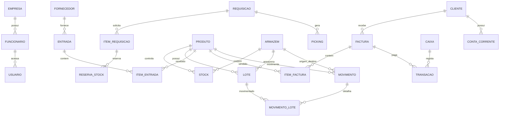

---

## 3. Modelo Logico por Modulo

### 3.1 Administracao e Acesso

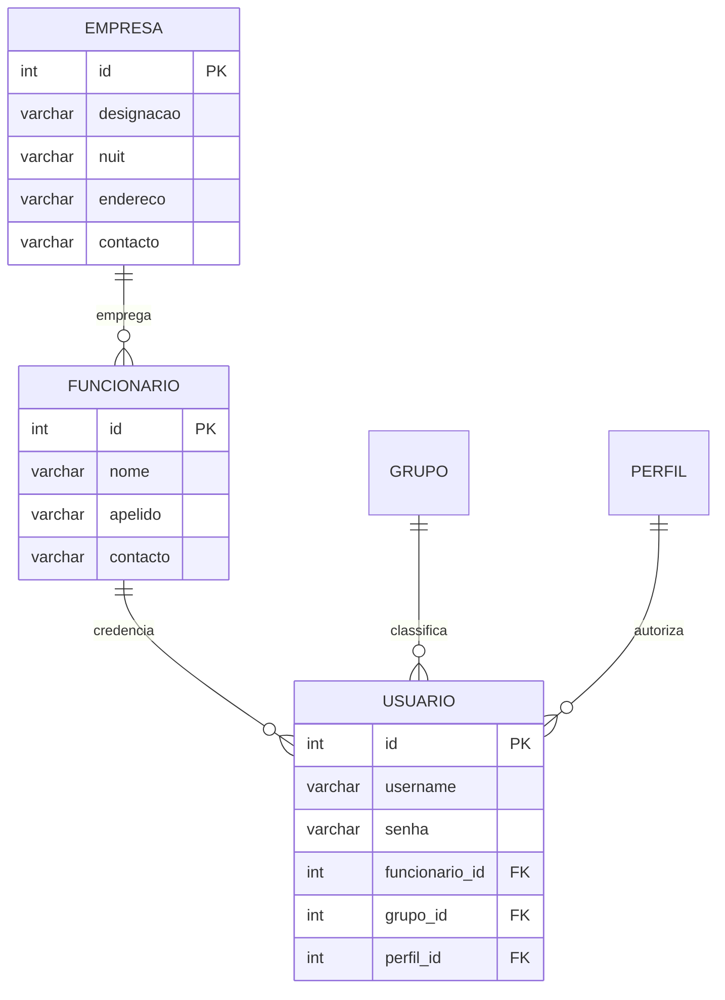

**Responsabilidade:** gerir os dados base do sistema e o acesso dos utilizadores.

**Observacoes importantes:**

- A senha deve ser armazenada com hash seguro na camada aplicacional ou em evolucao futura do modelo.
- Para produto standalone, pode existir um unico perfil administrador criado na instalacao inicial.

### 3.2 Produtos, Armazens, Stock e Lotes

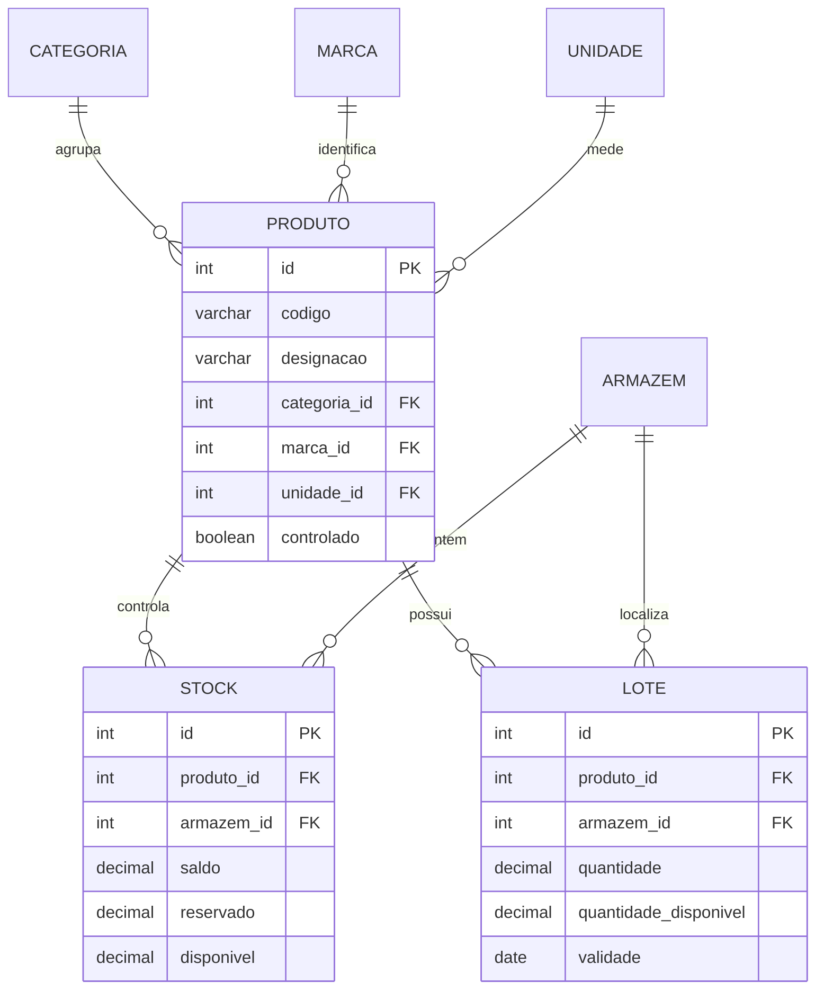

**Responsabilidade:** controlar o saldo fisico, saldo reservado e disponibilidade real dos produtos.

**Regra central:**

```text
stock.disponivel = stock.saldo - stock.reservado
```

Quando o produto e controlado em stock, as entradas, saidas e reservas devem afectar sempre o saldo do produto no armazem correspondente.

### 3.3 Entradas de Stock

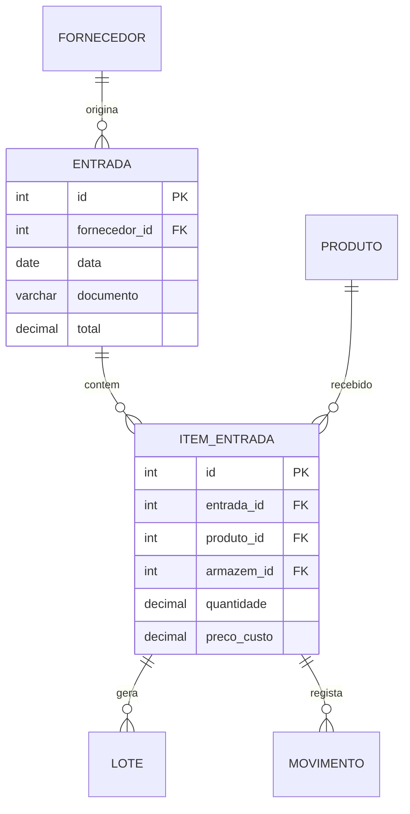

**Fluxo logico:**

1. Regista-se a entrada.
2. Registam-se os itens de entrada.
3. O sistema cria ou actualiza stock.
4. O sistema cria lote quando aplicavel.
5. O sistema cria movimento de entrada.

### 3.4 Requisicoes, Reservas e Picking

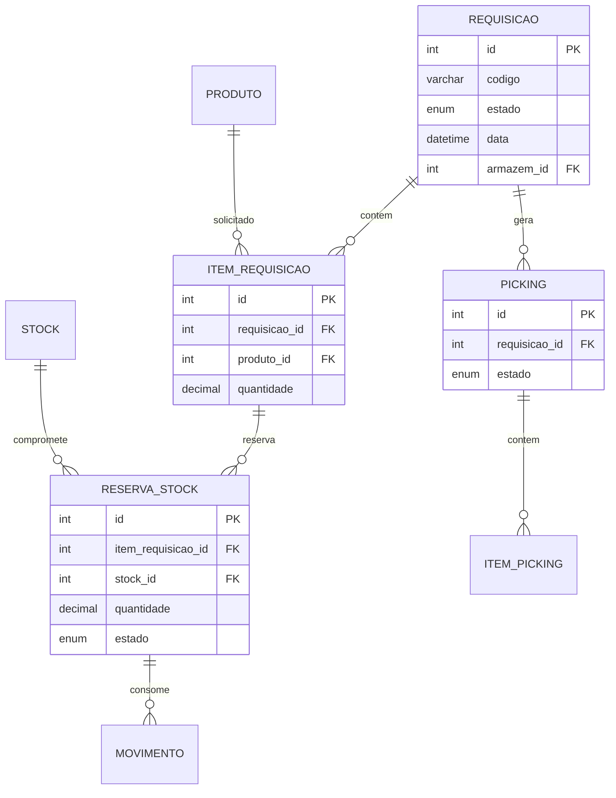

**Estados recomendados da requisicao:**

| Estado | Significado |
| --- | --- |
| `Pendente` | Requisicao criada, ainda editavel. |
| `Submetida` | Requisicao enviada para aprovacao. |
| `Aprovada` | Stock validado e reservado. |
| `Finalizada` | Picking confirmado e stock baixado. |
| `Cancelada` | Processo interrompido antes da finalizacao. |

**Fluxo operacional:**

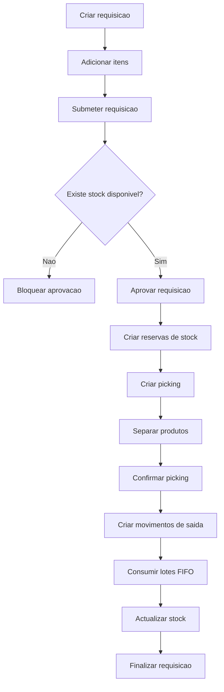

### 3.5 Transferencias entre Armazens

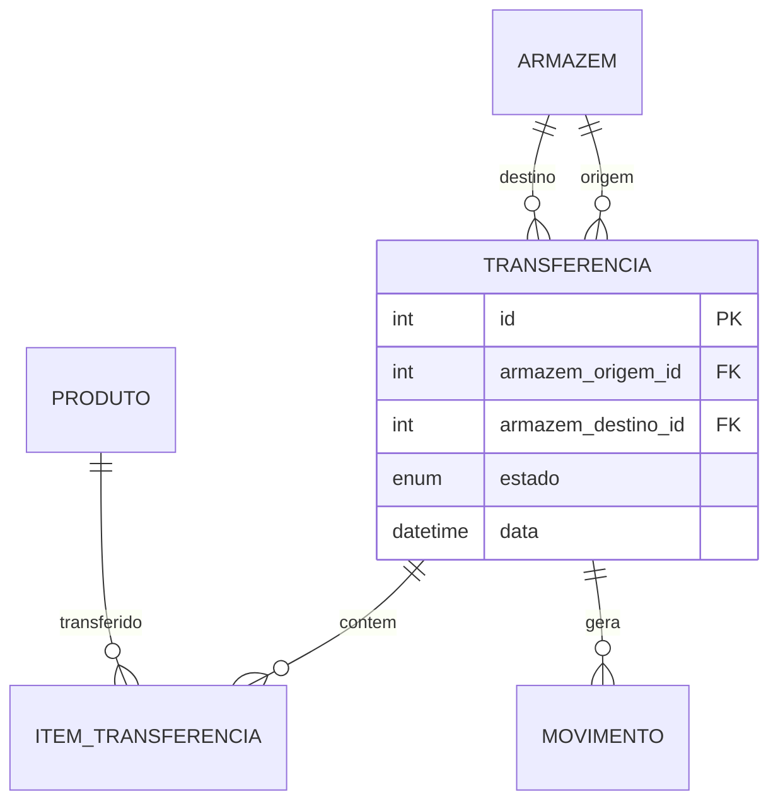

**Responsabilidade:** permitir movimentacao interna de stock entre armazens.

**Observacao:** a transferencia deve respeitar a mesma disciplina de stock disponivel usada nas requisicoes e vendas. Para evolucao futura, recomenda-se associar transferencia a lotes especificos ou aplicar FIFO de forma consistente.

### 3.6 Facturacao e Vendas

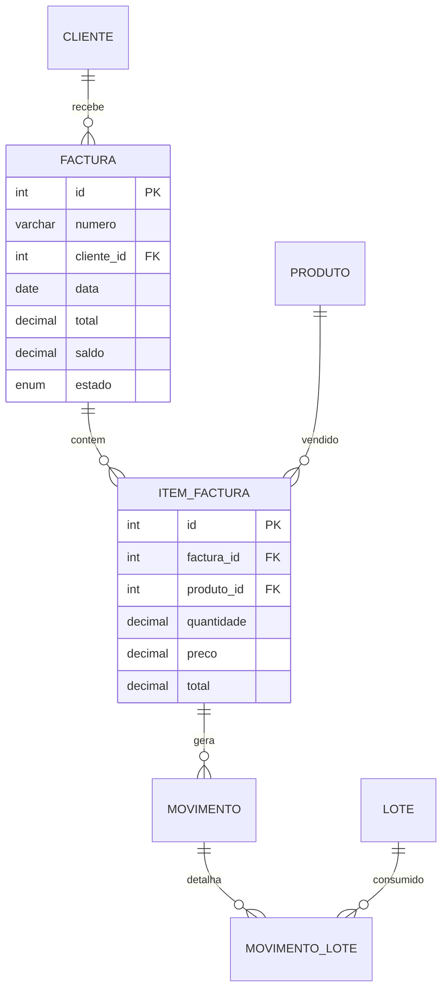

**Fluxo de venda:**

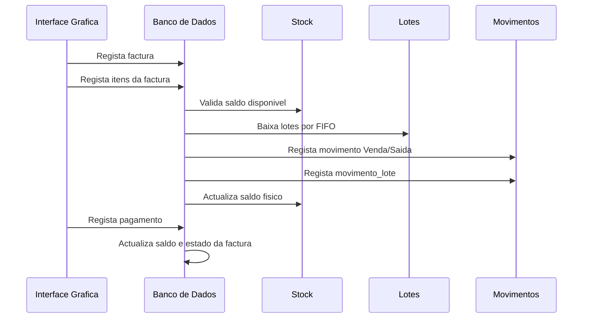

**Regra importante:** a venda so deve ser concluida quando houver stock disponivel suficiente. A saida deve afectar:

- `stock.saldo`
- `lote.quantidade_disponivel`
- `movimento`
- `movimento_lote`

### 3.7 Pagamentos, Caixa e Conta Corrente

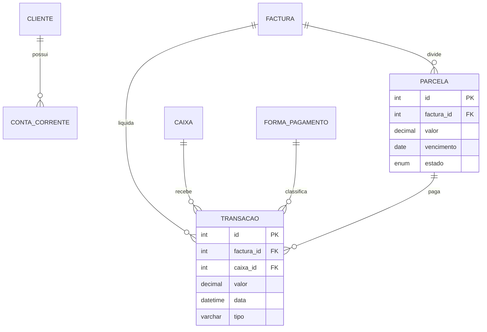

**Responsabilidade:** controlar liquidacoes, recebimentos, saldos de factura, caixa e conta corrente.

**Fluxos esperados:**

- Pagamento a vista: factura emitida, pagamento registado, caixa actualizado e factura liquidada ou parcialmente liquidada.
- Pagamento parcelado: parcelas criadas, vencimentos acompanhados, juros/taxas aplicadas quando configurado.

### 3.8 Precos, Descontos e Impostos

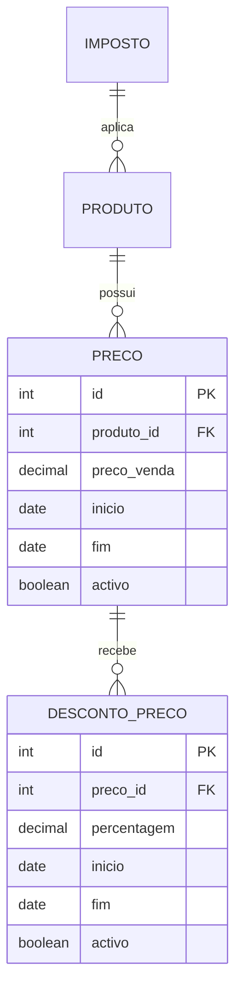

**Responsabilidade:** manter historico e vigencia dos precos, descontos e impostos aplicaveis.

---

## 4. Modelo Fisico

### 4.1 Plataforma

| Item | Valor |
| --- | --- |
| SGBD | MySQL / MariaDB compativel |
| Schema de teste | `_sysface_teste` |
| Codificacao recomendada | `utf8mb4` |
| Motor recomendado | `InnoDB` |
| Uso | Produto standalone/local |

### 4.2 Convencoes Observadas

| Aspecto | Observacao |
| --- | --- |
| Chaves primarias | Predominantemente inteiros auto-incrementais. |
| Relacionamentos | Implementados via FKs em varias tabelas centrais. |
| Nomes | Ha mistura de estilos; recomenda-se padronizacao futura. |
| Regras automaticas | Concentradas em triggers, procedures e events. |
| Stock disponivel | Calculado a partir de saldo menos reservado. |

### 4.3 Entidades Centrais e Relacionamentos

| Entidade | Papel no Modelo | Relacionamentos Principais |
| --- | --- | --- |
| `produto` | Artigo vendido, comprado ou requisitado. | Categoria, marca, unidade, stock, lote, factura, requisicao. |
| `stock` | Saldo por produto/armazem. | Produto, armazem, reserva, movimento. |
| `lote` | Rastreio de quantidade disponivel por origem/validade. | Produto, armazem, movimento_lote. |
| `movimento` | Historico de entradas e saidas. | Produto, armazem, movimento_lote. |
| `movimento_lote` | Detalhe de lote consumido/afectado por movimento. | Movimento, lote. |
| `factura` | Documento comercial de venda. | Cliente, itemfactura, transacoes, parcelas. |
| `itemfactura` | Linha de venda. | Factura, produto. |
| `requisicao` | Pedido interno de produtos. | Itens, picking, reservas. |
| `reserva_stock` | Bloqueio temporario de stock disponivel. | Item de requisicao, stock. |
| `picking` | Separacao de produtos aprovados. | Requisicao, itens de picking. |
| `transacoes` | Pagamentos e movimentos financeiros. | Factura, caixa, forma de pagamento. |

---

## 5. Dicionario de Dados Resumido

### 5.1 Administracao

| Tabela | Responsabilidade | PK | Observacoes |
| --- | --- | --- | --- |
| `empresa` | Dados da entidade que usa o sistema. | `id` | Base para documentos e relatorios. |
| `funcionario` | Pessoas internas da empresa. | `id` | Pode estar associado a utilizador. |
| `usuario` | Credenciais de acesso. | `id` | Recomenda-se senha com hash. |
| `grupo` | Agrupamento de utilizadores. | `id` | Usado para organizacao/permissao. |
| `perfil` | Perfil de acesso. | `id` | Pode suportar autorizacoes. |

### 5.2 Cadastros Comerciais

| Tabela | Responsabilidade | PK | Observacoes |
| --- | --- | --- | --- |
| `cliente` | Clientes de venda. | `id` | Relaciona-se com factura e conta corrente. |
| `fornecedor` | Fornecedores de compra. | `id` | Relaciona-se com entradas. |
| `contacto` | Contactos adicionais. | `id` | Suporte a clientes/fornecedores/empresa. |
| `documento` | Documentos de referencia. | `id` | Pode classificar documentos comerciais. |
| `imposto` | Configuracao fiscal. | `id` | IVA e outros impostos. |
| `forma_pagamento` | Meios de pagamento. | `id` | Caixa, banco, numerario etc. |

### 5.3 Produtos e Stock

| Tabela | Responsabilidade | PK | Observacoes |
| --- | --- | --- | --- |
| `produto` | Cadastro de artigos. | `id` | Entidade central do inventario. |
| `categoria` | Classificacao de produtos. | `id` | Agrupamento comercial. |
| `marca` | Marca do produto. | `id` | Opcional conforme negocio. |
| `unidade` | Unidade de medida. | `id` | Ex.: unidade, caixa, kg. |
| `armazem` | Local fisico/logico de stock. | `id` | Base para saldo por produto. |
| `stock` | Saldo por produto/armazem. | `id` | Contem saldo, reservado e disponivel. |
| `lote` | Quantidade rastreavel por produto/armazem. | `id` | Usado em FIFO e validade. |

### 5.4 Entradas

| Tabela | Responsabilidade | PK | Observacoes |
| --- | --- | --- | --- |
| `entrada` | Cabecalho de compra/entrada. | `id` | Associada a fornecedor. |
| `itementrada` | Linhas da entrada. | `id` | Actualiza stock e lote. |

### 5.5 Requisicoes

| Tabela | Responsabilidade | PK | Observacoes |
| --- | --- | --- | --- |
| `requisicao` | Pedido interno. | `id` | Controlado por estados. |
| `itemrequisicao` | Produtos solicitados. | `id` | Base para reserva. |
| `reserva_stock` | Reserva de saldo disponivel. | `id` | Aumenta `stock.reservado`. |
| `picking` | Processo de separacao. | `id` | Criado apos aprovacao. |
| `itempicking` | Itens separados. | `id` | Detalhe operacional do picking. |

### 5.6 Transferencias

| Tabela | Responsabilidade | PK | Observacoes |
| --- | --- | --- | --- |
| `transferencia` | Cabecalho da transferencia. | `id` | Origem, destino e estado. |
| `itemtransferencia` | Produtos transferidos. | `id` | Deve validar stock disponivel. |

### 5.7 Facturacao

| Tabela | Responsabilidade | PK | Observacoes |
| --- | --- | --- | --- |
| `factura` | Documento de venda. | `id` | Controla total, saldo e estado. |
| `itemfactura` | Linhas da factura. | `id` | Dispara saida de stock. |
| `cotacao` | Proposta/orcamento. | `id` | Pode originar venda. |
| `itemcotacao` | Linhas da cotacao. | `id` | Inclui unidade e quantidade por unidade. |

### 5.8 Financeiro

| Tabela | Responsabilidade | PK | Observacoes |
| --- | --- | --- | --- |
| `transacoes` | Recebimentos/pagamentos. | `id` | Afecta caixa e factura. |
| `caixa` | Saldos de caixa. | `id` | Controla entradas financeiras. |
| `conta_corrente` | Saldo por cliente. | `id` | Apoia credito e debito. |
| `parcela` | Pagamentos parcelados. | `id` | Controla vencimento e atraso. |

### 5.9 Precos

| Tabela | Responsabilidade | PK | Observacoes |
| --- | --- | --- | --- |
| `preco` | Historico/vigencia de preco. | `id` | Um produto pode ter varios precos ao longo do tempo. |
| `desconto_preco` | Desconto associado ao preco. | `id` | Deve respeitar periodo de validade. |

---

## 6. Regras de Negocio Automatizadas

### 6.1 Regras de Stock

1. Produto controlado deve possuir linha em `stock` para o armazem correspondente.
2. Entrada de produto aumenta `stock.saldo`.
3. Saida por venda diminui `stock.saldo`.
4. Requisicao aprovada aumenta `stock.reservado`.
5. Picking confirmado consome a reserva e diminui `stock.saldo`.
6. O stock disponivel deve considerar sempre o saldo menos o reservado.
7. Lotes devem ser consumidos por FIFO quando houver saida.

### 6.2 Regras de Reserva

1. Nao deve ser possivel reservar mais do que o disponivel.
2. Reserva activa aumenta `stock.reservado`.
3. Reserva consumida, liberada ou cancelada reduz `stock.reservado`.
4. A aprovacao da requisicao so deve ocorrer quando todos os itens possuem stock suficiente.

### 6.3 Regras de Venda

1. Cada item de factura deve validar stock disponivel.
2. A saida deve criar movimento com origem de venda.
3. A saida deve registar os lotes consumidos.
4. O saldo do lote e o saldo do stock devem ser actualizados na mesma operacao logica.

### 6.4 Regras Financeiras

1. Pagamentos devem reduzir o saldo da factura.
2. Pagamentos a vista devem actualizar caixa.
3. Parcelas vencidas podem actualizar estado e aplicar taxa de atraso.
4. Factura deve mudar de estado conforme saldo pendente.

---

## 7. Inventario de Triggers

| Trigger | Modulo | Responsabilidade |
| --- | --- | --- |
| `Tg_C_Stock` | Inventario | Criar/garantir stock para produto controlado. |
| `copiar_saldo_para_lote` | Entradas/Lotes | Replicar quantidade inicial para disponibilidade do lote. |
| `Tg_registaMovimentoEntrada` | Entradas | Registar movimento de entrada por compra. |
| `Tg_actualizaStock_IO` | Entradas | Actualizar saldo de stock apos entrada. |
| `Tg_reservaStock_validar` | Requisicoes | Validar disponibilidade antes de reservar. |
| `Tg_reservaStock` | Requisicoes | Aumentar reservado apos reserva activa. |
| `Tg_reservaStock_estado` | Requisicoes | Libertar reservado quando reserva muda de estado. |
| `Tg_estadoRequisicao` | Requisicoes | Controlar estado inicial/submissao da requisicao. |
| `Tg_FIFO` | Stock/Lotes | Apoiar consumo FIFO de lotes. |
| `Tg_C_Saida` | Vendas | Registar saida de stock por venda, lote e movimento. |
| Triggers financeiros `_update...` | Financeiro | Actualizar factura, caixa, conta corrente e saldos. |

---

## 8. Inventario de Procedures e Events

### 8.1 Procedures

| Procedure | Modulo | Responsabilidade |
| --- | --- | --- |
| `AprovarRequisicao` | Requisicoes | Validar stock, criar reservas e gerar picking. |
| `ConfirmarPicking` | Requisicoes | Consumir reservas, baixar stock/lotes e finalizar requisicao. |
| `EnviarTransferencia` | Transferencias | Registar envio entre armazens. |
| `ReceberTransferencia` | Transferencias | Confirmar recepcao no armazem destino. |
| `sp_registar_preco` | Precos | Registar novo preco com vigencia. |
| `sp_aplicar_desconto_ao_preco` | Precos | Aplicar desconto a preco existente. |
| `procedure_updatePrecoVenda` | Precos | Actualizar preco de venda. |
| `procedure_updateEstadoParcela` | Financeiro | Actualizar estado de parcelas. |
| `procedure_updateTaxaAtrasoParcela` | Financeiro | Calcular taxa de atraso. |
| `procedure_updateSaldoFactura_com_Atraso_de_Parcela` | Financeiro | Actualizar saldo de factura com atrasos. |

### 8.2 Events

| Event | Modulo | Responsabilidade |
| --- | --- | --- |
| `evt_marcar_expiracao_precos` | Precos | Expirar precos fora de vigencia. |
| `evento_updatePrecoVenda` | Precos | Actualizacao periodica de preco de venda. |
| `evento_updateEstadoParcela` | Financeiro | Actualizacao periodica de estado de parcelas. |
| `evento_updateTaxaAtrasoParcela` | Financeiro | Actualizacao periodica de taxa de atraso. |
| `evento_updateSaldoFactura_com_Atraso_de_Parcela` | Financeiro | Actualizacao periodica de saldos com atraso. |

---

## 9. Fluxos Detalhados

### 9.1 Entrada de Stock

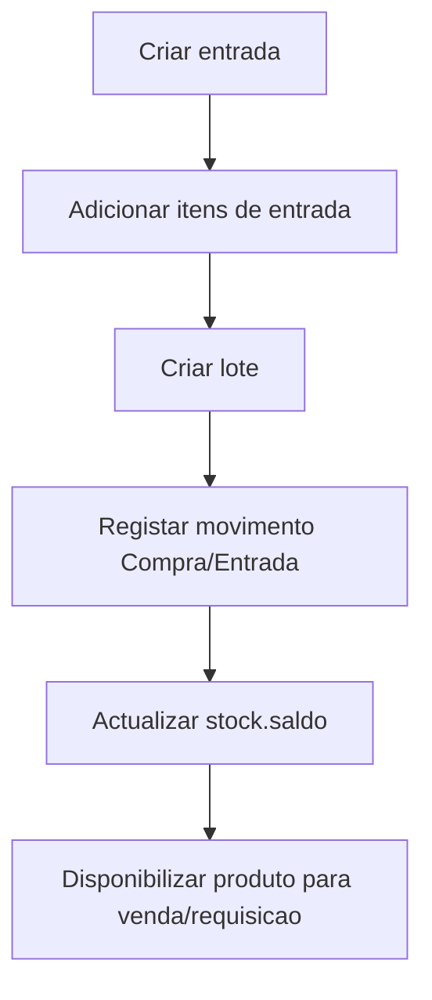

### 9.2 Venda com Baixa de Stock

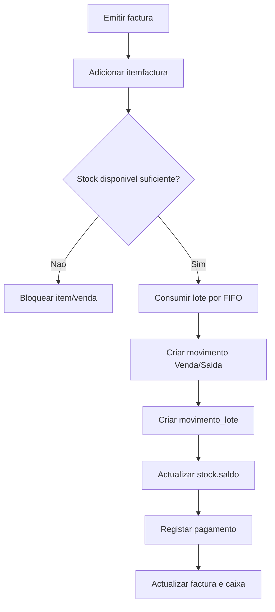

### 9.3 Requisicao com Reserva

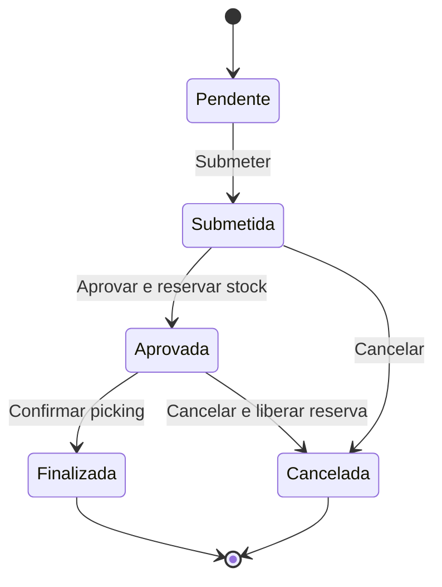

### 9.4 Pagamento Parcelado

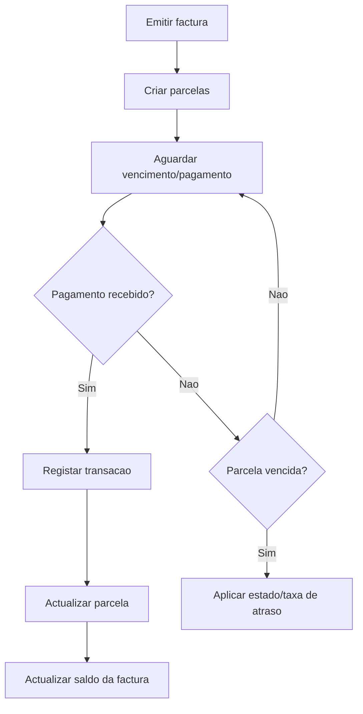

---

## 10. Consideracoes para Produto Generico Standalone

### 10.1 Instalacao Local

O produto deve funcionar em uma maquina local ou rede pequena, com banco MySQL/MariaDB instalado localmente ou em servidor interno. A base deve ser autocontida, com todos os cadastros, movimentos e historico mantidos no ambiente do cliente.

### 10.2 Portabilidade

Para facilitar instalacao em diferentes clientes:

- Manter scripts de criacao separados por responsabilidade.
- Evitar dependencias externas para regras essenciais.
- Criar rotina de backup e restauracao.
- Manter dados de teste separados dos dados reais.
- Permitir renomear schema de teste para schema de producao.

### 10.3 Segurança

Recomendacoes:

- Guardar senhas com hash seguro.
- Evitar credenciais fixas nos scripts.
- Criar perfil administrador inicial no instalador.
- Restringir permissao de alteracao directa em tabelas criticas.
- Registar auditoria para cancelamentos, ajustes de stock e alteracoes financeiras.

### 10.4 Integridade Operacional

Para evitar divergencias:

- Operacoes de venda, requisicao, transferencia e pagamento devem ser transaccionais.
- Triggers e procedures devem falhar com erro claro quando houver stock insuficiente.
- Validacoes da interface grafica devem repetir as regras principais antes de enviar ao banco.
- Rotinas de manutencao devem reconciliar `stock`, `lote`, `movimento` e `movimento_lote`.

---

## 11. Pontos de Atencao e Melhorias Futuras

| Area | Recomendacao |
| --- | --- |
| Nomenclatura | Padronizar nomes de tabelas e colunas em um unico estilo. |
| Codificacao | Manter todos os scripts em UTF-8 sem BOM. |
| Indices | Garantir indices em todas as FKs e colunas de busca frequente. |
| Auditoria | Criar tabela de auditoria para operacoes sensiveis. |
| Transferencias | Reforcar controle por lote/FIFO, similar a vendas e requisicoes. |
| Passwords | Substituir senha simples por hash. |
| Estados | Centralizar estados em ENUMs ou tabelas de dominio. |
| Financeiro | Consolidar nomenclatura de transaccoes, parcelas e conta corrente. |
| Backup | Criar rotina automatica de backup local. |
| Migracoes | Versionar evolucoes do banco em scripts incrementais. |

---

## 12. Matriz de Validacao Recomendada

| Cenario | Resultado Esperado |
| --- | --- |
| Criar produto controlado | Linha de stock preparada para o armazem. |
| Registar entrada | Stock aumenta, lote e movimento de entrada sao criados. |
| Aprovar requisicao sem stock | Operacao bloqueada. |
| Aprovar requisicao com stock | Reserva criada e `stock.reservado` aumenta. |
| Confirmar picking | Reserva consumida, stock baixa, lote baixa e movimento e criado. |
| Emitir venda com stock | Stock e lote baixam, movimento Venda/Saida e criado. |
| Emitir venda sem stock | Operacao bloqueada. |
| Registar pagamento total | Factura liquidada e caixa actualizado. |
| Registar pagamento parcial | Saldo da factura permanece pendente. |
| Vencer parcela | Estado/taxa de atraso actualizados por rotina. |

---

## 13. Mapa de Dependencias entre Scripts

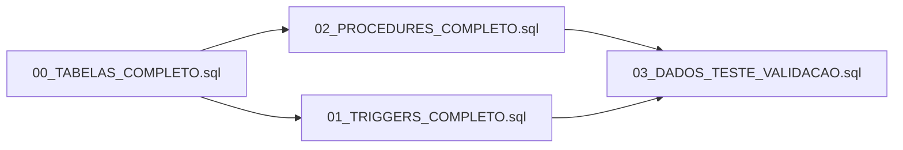

**Justificativa:**

- As tabelas precisam existir antes das procedures, triggers e dados.
- Procedures devem existir antes de testes que chamam rotinas de negocio.
- Triggers devem existir antes dos testes de validacao de movimentos automaticos.
- Dados de teste devem ser executados por ultimo.

---

## 14. Resumo Executivo

O banco de dados suporta um sistema standalone de facturacao e inventario com regras automaticas robustas para stock, requisicoes, vendas e pagamentos. A arquitectura actual concentra boa parte da consistencia no banco por meio de triggers e procedures, o que e adequado para proteger a integridade mesmo quando a interface grafica envia operacoes incompletas.

Os pontos mais criticos do modelo sao:

- controlo de stock por produto e armazem;
- consumo de lotes por FIFO;
- separacao entre saldo fisico, saldo reservado e saldo disponivel;
- movimentos rastreaveis de entrada e saida;
- actualizacao financeira apos pagamento;
- fluxo formal de requisicao ate picking e finalizacao.

Para transformar este banco em base de um produto generico e reutilizavel, recomenda-se manter os scripts organizados por modulo, acrescentar migracoes versionadas, reforcar auditoria e padronizar nomes/estados antes de distribuicao em clientes finais.
